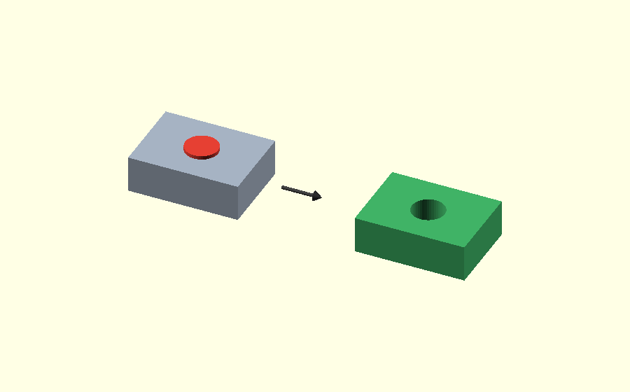
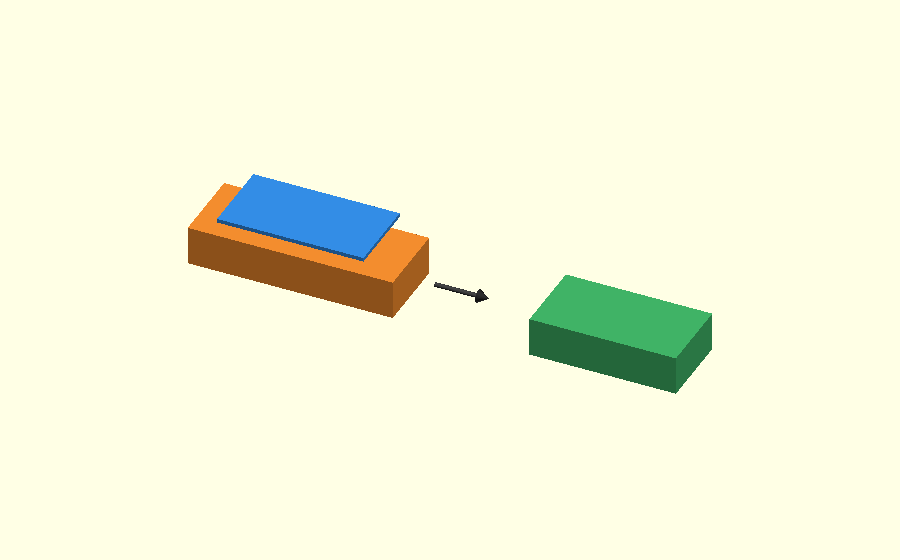
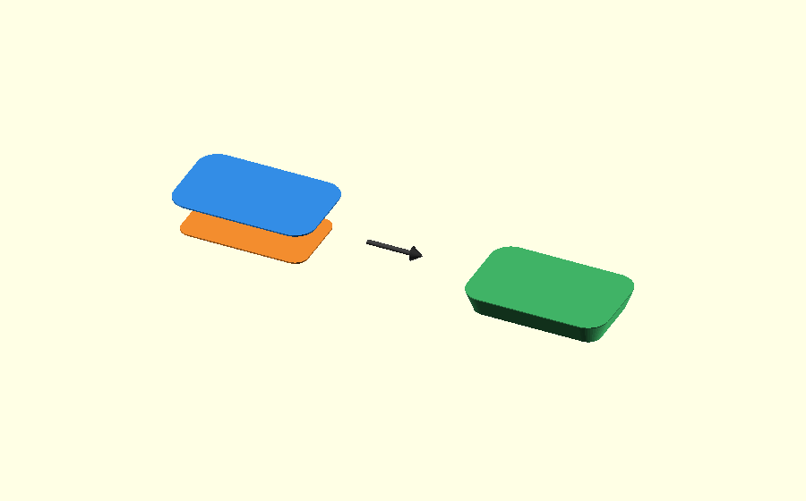
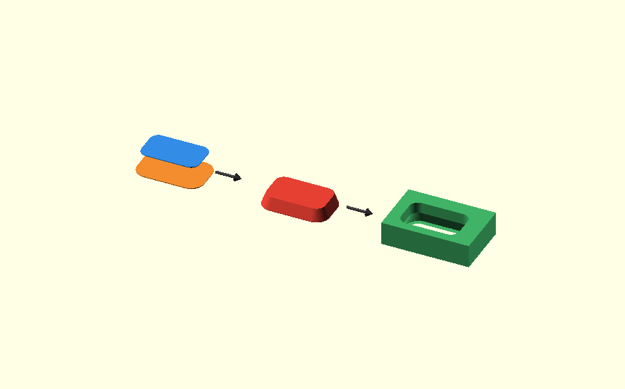
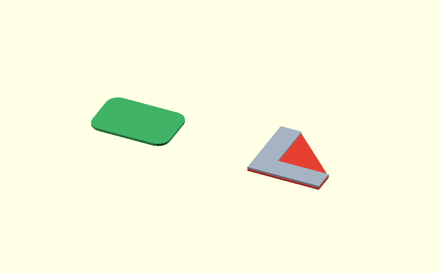
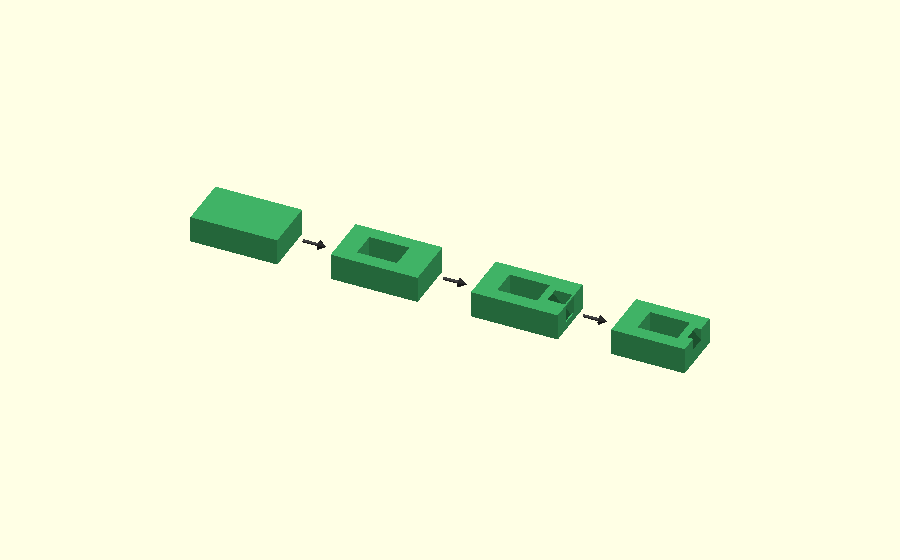

# OpenSCAD design concepts

This page explains a few modelling ideas that come back in many OpenSCAD models in this archive.

The easiest way to understand them is not to start with commands such as `difference()`, `intersection()` or `hull()`.

Start with a simpler question:

**What do I want this temporary shape to do?**

Usually it does one of three jobs:

- it describes material that should **stay**;
- it describes material that should **go away**;
- or it describes the **boundary** inside which the final part must fit.

Once that is clear, the OpenSCAD operation becomes much easier to choose.

## 1. A shape can describe material that stays

On the left you see the two profiles we start with. The orange profile is smaller; the blue profile is the normal size.

The arrow means: connect these profiles.

On the right you see the green result. That is the actual material we want to keep.

~~~openscad
hull() {
    small_profile();
    normal_profile();
}
~~~

Nothing is cut away afterward. The hull itself is the part.

This is useful when the shape you want to **keep** is easy to describe directly.

## 2. A shape can describe material that must be removed

On the left, the grey block is the part and the red cylinder describes the material we want to remove.

On the right you see the result after `difference()`: the red cylinder is gone and only the hole remains.

~~~openscad
difference() {
    body();
    hole();
}
~~~

After `difference()`, the red volume is gone and a hole remains.

This way of thinking is useful for many things:

- holes;
- nut pockets;
- clearances;
- reliefs;
- chamfers around an opening;
- print compensation.

If the unwanted material is easier to draw than the final surface, drawing a cutter is often the simplest solution.

## 3. A shape can describe the final boundary

On the left, the orange part is deliberately too long. The blue plate above it shows the X/Y footprint that is allowed to remain.

On the right you see the result: only the overlap survives.

That is what `intersection()` does.

~~~openscad
intersection() {
    overlong_part();
    final_bounds();
}
~~~

The green part is the overlap between the two shapes.

This is useful when you want to keep the feature construction simple and set the exact final length only afterward.

An important point:

**The blue box does not create the feature. It only trims the finished geometry.**

## 4. hull() can make something that stays

On the left, the orange layer is smaller than the blue layer.

`hull()` connects them.

On the right, the green sloped body is the result. In this case that hull is the material we actually want to keep.

~~~openscad
hull() {
    smaller_layer();
    normal_layer();
}
~~~

Here `hull()` is used to build the material that remains in the final part.

This is a natural way to make an outside chamfer when the two profiles are easy to define.

## 5. hull() can also make a cutter

This picture uses the same basic idea, but the purpose is different.

On the left are two opening profiles: the orange opening is larger than the blue one.

In the middle, `hull()` connects them and creates the red tapered solid.

On the right, that red solid has been subtracted from the body together with the normal opening. The result is the green part with a chamfer around the hole.

That red hull is therefore only a cutter:

~~~openscad
difference() {
    body();

    hull() {
        larger_opening();
        normal_opening();
    }
}
~~~

So `hull()` does **not** mean "keep this".

It only creates a shape.

What happens to that shape depends on how you use it afterward.

That is why this is the better way to think about `hull()`:

> **hull() makes a transition between shapes.**
>
> That transition can become part of the model, or it can become a cutter.

## 6. Why convex shapes are easy for hull()

The left side shows a rounded rectangle.

That shape is convex. There is no notch or missing inside corner that `hull()` has to preserve.

Connecting two such profiles gives a predictable result.

The right side shows an L-shaped profile in grey. Under it you can see the red convex hull of that same L.

The open inside corner is important. But `hull()` fills across that missing corner.

The visible red triangle is the unwanted bridge.

This is the main limitation to remember:

**A global hull cannot keep a concave notch open.**

If the shape has an important opening, notch or re-entrant corner, you often need another approach:

- build a simpler outside shape and cut the opening afterward;
- use a local cutter;
- use several smaller hulls;
- or build slightly too much and clip it later.

## 7. Complex parts do not have to be made in one operation

A finished part can look complicated while the construction stays simple.

The picture reads from left to right:

1. start with an easy outside body;
2. subtract the main opening;
3. subtract a small local detail;
4. trim the overlong end to its final length.

In OpenSCAD that often looks roughly like this:

~~~openscad
intersection() {
    difference() {
        outer_body();
        inner_void();
        local_cut();
    }

    final_bounds();
}
~~~

Do not read that as "this is the correct formula for every model".

The useful idea is the order:

**Build the easy large shapes first. Add or remove local details afterward. Trim last when that keeps the earlier steps simpler.**

## 8. How to choose an approach

When you add a feature, ask these questions in this order.

### What should physically happen?

Should material remain, disappear, or simply be limited to a final boundary?

### Which shape is easiest to draw?

Sometimes the final surface is awkward, but the unwanted material is a very simple wedge or cylinder.

In that case, draw the cutter.

Sometimes the desired outside body is already easy to describe with two profiles.

In that case, build the body directly.

### Does hull() have to preserve an opening?

If yes, check whether the profile is concave.

A global `hull()` may close that opening.

### Can I split the problem?

A complicated shell often becomes much easier when you separately describe:

- the outer body;
- the inner opening;
- a few local cutters;
- the final bounds.

## 9. Chamfers are a good example

A chamfer can be made in different ways depending on which geometry is simplest.

For an outside edge:

~~~text
smaller outside profile
        +
normal outside profile
        ↓
      hull()
        ↓
material that stays
~~~

For an inside edge around an opening:

~~~text
larger opening
      +
normal opening
      ↓
    hull()
      ↓
cutting volume
      ↓
 difference()
~~~

If the part was deliberately made too long while constructing those chamfers:

~~~text
finished feature geometry
        +
final bounding box
        ↓
  intersection()
        ↓
exact final length
~~~

These are three separate jobs. They should not be treated as one fixed "chamfer recipe".

## 10. Prefer the simplest model that really works

It is easy to make an OpenSCAD model more complicated because a particular technique looks elegant.

That is not automatically an improvement.

A good construction should be:

- easy to understand from the intermediate shapes;
- correct for all required edges and corners;
- reasonably short;
- stable when parameters change;
- easy to test.

If a small cutter clearly describes the material that must disappear, using that cutter can be better than replacing it with several hulls.

If two profiles naturally describe a sloped outside body, `hull()` can be the clearest solution.

Use the operation that matches the geometry, not the operation that happens to be fashionable elsewhere in the model.

## Examples in this archive

The [rounded rectangular tube](../examples/rounded-rectangular-tube/v0.1/) shows two uses of `hull()`:

- the outside hull creates material that stays;
- the inside hull creates a cutter.

The [rounded L bracket](../examples/rounded-l-bracket/v0.1/) adds another idea:

- the profiles are deliberately made a little too long;
- the exact leg lengths are imposed afterward with one final `intersection()`.

Those examples contain the detailed step-by-step construction. This page is meant to give the simpler vocabulary for understanding why those steps are used.
