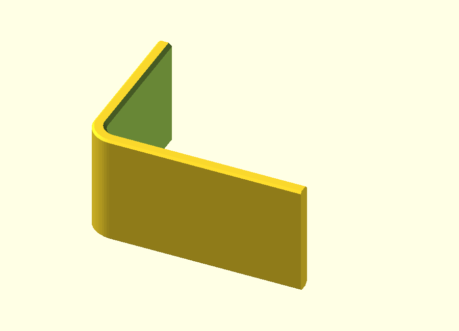
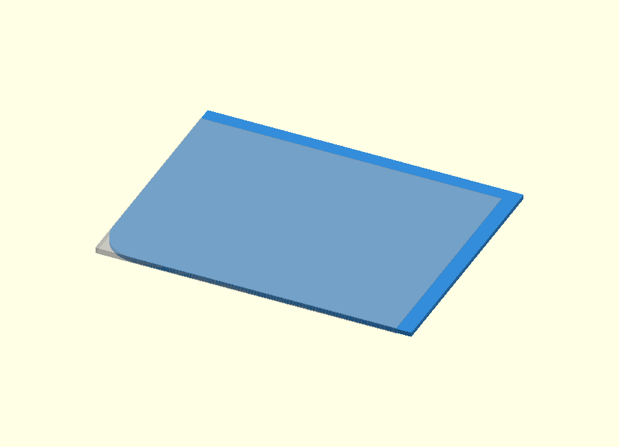
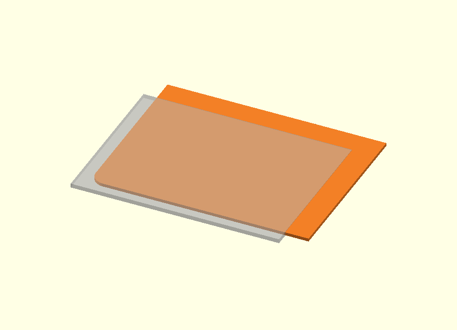
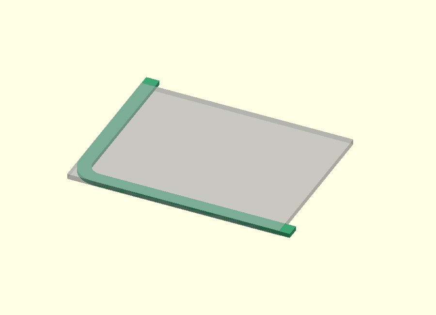
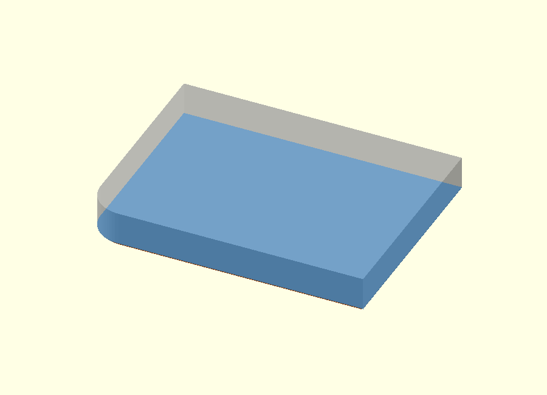
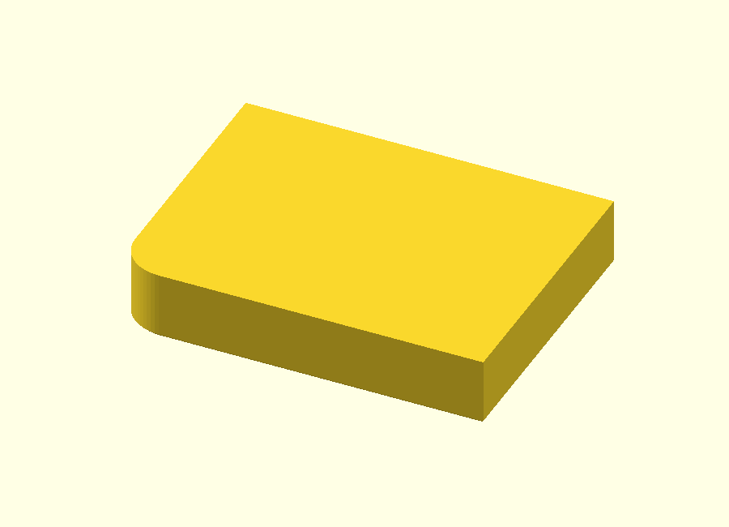
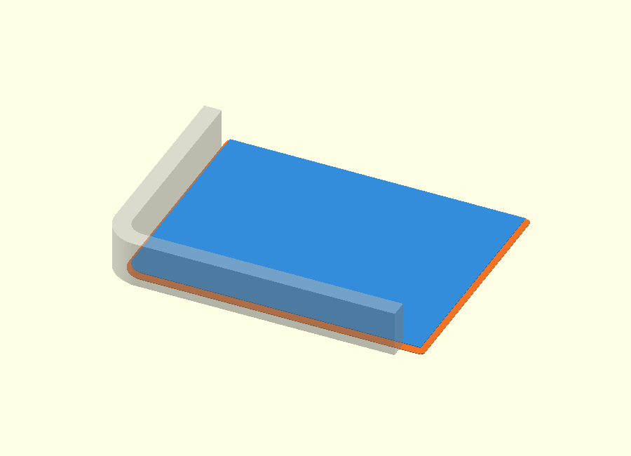
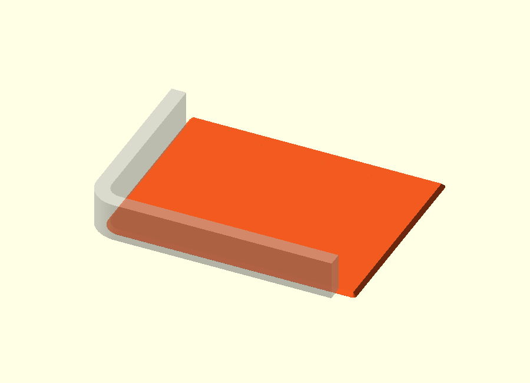
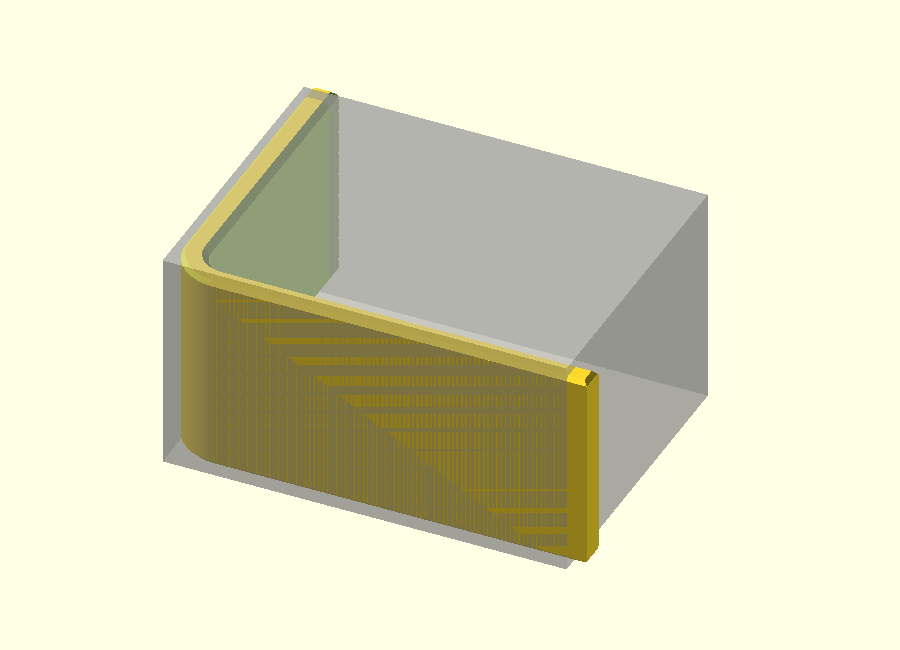
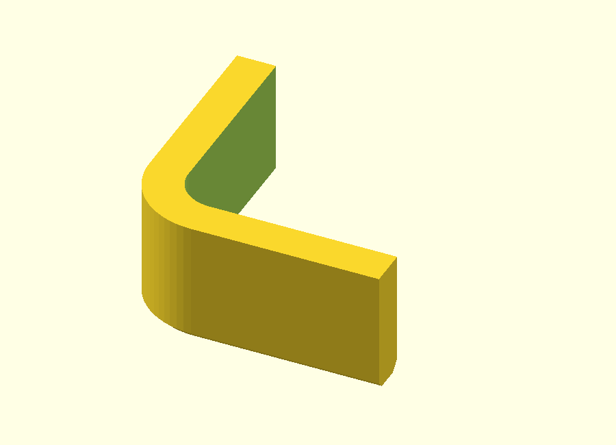

# Rounded L bracket with end chamfers — v0.1

This standalone OpenSCAD example builds an **L-shaped shell** with a rounded inside corner and separate chamfers on the outside and inside edges of both Z end faces.

The construction uses a useful modelling trick: the outer profile and the inner cutout are first made as **simple convex shapes that deliberately extend past the final leg lengths**. All chamfer operations are completed on those clean profiles. Only at the end are the two leg ends trimmed flat.

## Files

- [Printable example](scad/rounded_l_bracket.scad)
- [Editable construction walkthrough](design/rounded_l_bracket_explained.scad)

The walkthrough uses a `design_step` selector and exposes the intermediate geometry one operation at a time.

For the shared terminology used here — **keep geometry**, **cut geometry**,
**clip / trim geometry**, and the role of `hull()` — see the
[OpenSCAD design concepts](../../../docs/design-concepts.html).

## Parameters

| Parameter | Default | Meaning |
| --- | ---: | --- |
| `leg_x` | 40 mm | Final leg length along X |
| `leg_y` | 30 mm | Final leg length along Y |
| `height` | 20 mm | Height along Z |
| `wall_thickness` | 2.5 mm | Nominal wall thickness |
| `outer_radius` | 5 mm | Outside corner radius |
| `inner_chamfer` | 0.6 mm | Chamfer on the inside edge |
| `outer_chamfer` | 0.4 mm | Chamfer on the outside edge |

The inner radius follows the wall thickness:

~~~openscad
inner_radius = max(outer_radius - wall_thickness, 0.01);
~~~

The construction profiles are intentionally a little longer than the final legs:

~~~openscad
profile_x = leg_x + 2;
profile_y = leg_y + 2;
~~~

Those extra 2 mm are temporary and are removed in the final step.

## Construction at a glance

~~~text
1. make extended convex outer profile
2. make extended convex inner cutout
3. create outside end chamfers
4. subtract the normal inner cutout
5. subtract inside-chamfer cutters
6. trim both leg ends to final length
~~~

The final L shape therefore appears only after the clean chamfer geometry has already been built.

## Step A — Build the extended outer profile

The outer 2D shape is made with one rounded corner and two thin rectangles at the far ends:

~~~openscad
module outer_2d() {
    hull() {
        translate([outer_radius, outer_radius])
            circle(outer_radius);

        translate([profile_x - epsilon, 0])
            square([epsilon, profile_y]);

        translate([0, profile_y - epsilon])
            square([profile_x, epsilon]);
    }
}
~~~

The three inputs are all part of one convex outline. `hull()` therefore creates:

- one rounded corner near the origin;
- one straight leg running in X;
- one straight leg running in Y;
- a filled region between them.

The profile extends 2 mm beyond the final leg limits. The ghosted rectangle in the image shows where the part will eventually be trimmed.

## Step B — Build the extended inner cutout

The inner cutout uses exactly the same idea, shifted inward by the wall thickness:

~~~openscad
module inner_2d() {
    translate([wall_thickness, wall_thickness])
        hull() {
            translate([inner_radius, inner_radius])
                circle(inner_radius);

            translate([profile_x - epsilon, 0])
                square([epsilon, profile_y]);

            translate([0, profile_y - epsilon])
                square([profile_x, epsilon]);
        }
}
~~~

This is also a convex shape and also extends beyond the final ends.

Keeping both profiles simple and extended is deliberate: no special end geometry is needed while the chamfers are being created.

## Step C — See the 2D shell before extrusion

Subtracting the inner profile from the outer profile gives the intended wall section:

~~~openscad
difference() {
    outer_2d();
    inner_2d();
}
~~~

This view is only explanatory. The printable model does not first extrude this shell; instead it creates the chamfered outer body and subtracts the inner volume later.

The extended ends are still visible at this stage.

## Step D — Define the outside chamfer

At the bottom end face, the outer profile is reduced by `outer_chamfer`:

~~~openscad
offset(r = -outer_chamfer)
    outer_2d();
~~~

Only `0.4 mm` higher, the normal profile is restored:

~~~text
Z = 0.0 mm   reduced outer profile
Z = 0.4 mm   normal outer profile
~~~

The same construction is repeated at the top.

## Step E — Create the chamfered outer body

One `hull()` connects the reduced bottom profile, the full middle profile and the reduced top profile:

~~~openscad
module outer_body() {
    hull() {
        linear_extrude(epsilon)
            offset(r = -outer_chamfer)
                outer_2d();

        translate([0, 0, outer_chamfer])
            linear_extrude(height - 2 * outer_chamfer)
                outer_2d();

        translate([0, 0, height - epsilon])
            linear_extrude(epsilon)
                offset(r = -outer_chamfer)
                    outer_2d();
    }
}
~~~

The result is still a solid body. The hollow portion has not yet been removed.

## Step F — Define the inside chamfer

At the bottom face the inner opening is enlarged by `inner_chamfer`:

~~~openscad
offset(r = inner_chamfer)
    inner_2d();
~~~

At `Z = inner_chamfer = 0.6 mm`, it has returned to its normal size.

~~~text
Z = 0.0 mm   enlarged inner cutout
Z = 0.6 mm   normal inner cutout
~~~

These layers describe a cutting volume rather than material that remains.

## Step G — Hull the inside-chamfer cutter

The enlarged and normal inner profiles are joined with `hull()`:

~~~openscad
module inner_chamfer_cut() {
    hull() {
        translate([0, 0, -epsilon])
            linear_extrude(2 * epsilon)
                offset(r = inner_chamfer)
                    inner_2d();

        translate([0, 0, inner_chamfer])
            linear_extrude(epsilon)
                inner_2d();
    }
}
~~~

This creates a solid tapered cutter. Most of that cutter lies inside the normal empty region. Only the extra rim overlaps the wall and creates the visible inside chamfer after subtraction.

The same cutter is mirrored at the top.

## Step H — Complete the shell before trimming

The model now contains all important finished geometry:

- the outside body with both outside chamfers;
- the continuous inner cutout;
- the bottom inside chamfer;
- the mirrored top inside chamfer.

But the X and Y legs are still intentionally too long.

The ghosted box shows the final limits.

## Step I — Trim the leg ends

The final dimensions are imposed with one `intersection()`:

~~~openscad
intersection() {
    before_trim();

    translate([0, 0, -1])
        cube([leg_x, leg_y, height + 2]);
}
~~~

`intersection()` keeps only the volume that lies inside the final `leg_x × leg_y` footprint.

This turns both temporary overlong ends into perfectly flat final faces without adding end-specific geometry to the earlier hull operations.

## Step J — Inspect the chamfers at the rounded corner

This view isolates the rounded-corner region and the lowest 8 mm.

It makes it easier to inspect:

- the outside chamfer;
- the inside chamfer;
- the rounded outer corner;
- the rounded inner cutout;
- the remaining wall between the two.

This is the most useful design view when changing `outer_radius`, `wall_thickness`, `outer_chamfer` or `inner_chamfer`.

## Why the deliberate overhang is useful

The extra 2 mm at the leg ends is not a tolerance and does not remain in the final part.

It separates two concerns:

~~~text
first:
build clean profile + chamfers

then:
apply exact final leg lengths
~~~

Without that temporary overhang, the profile construction and chamfer operations would also have to deal with the final end boundaries at the same time.

By trimming last, the chamfer code can work on simple continuous profiles and the exact leg lengths are enforced with one obvious final operation.

## Why `epsilon` exists

~~~openscad
epsilon = 0.01;
~~~

The small helper layers need non-zero thickness for `hull()`, and cutting volumes are allowed to overlap slightly across the end faces.

`epsilon` is only a CAD construction tolerance. It is not a print fit or clearance value.

## Complete final construction

The final module remains compact:

~~~openscad
module rounded_l_bracket() {
    intersection() {
        difference() {
            outer_body();

            translate([0, 0, -1])
                linear_extrude(height + 2)
                    inner_2d();

            inner_chamfer_cut();

            translate([0, 0, height])
                mirror([0, 0, 1])
                    inner_chamfer_cut();
        }

        translate([0, 0, -1])
            cube([leg_x, leg_y, height + 2]);
    }
}
~~~

The printable source contains only the construction itself. The separate design file exists to make the intermediate geometry visible.
