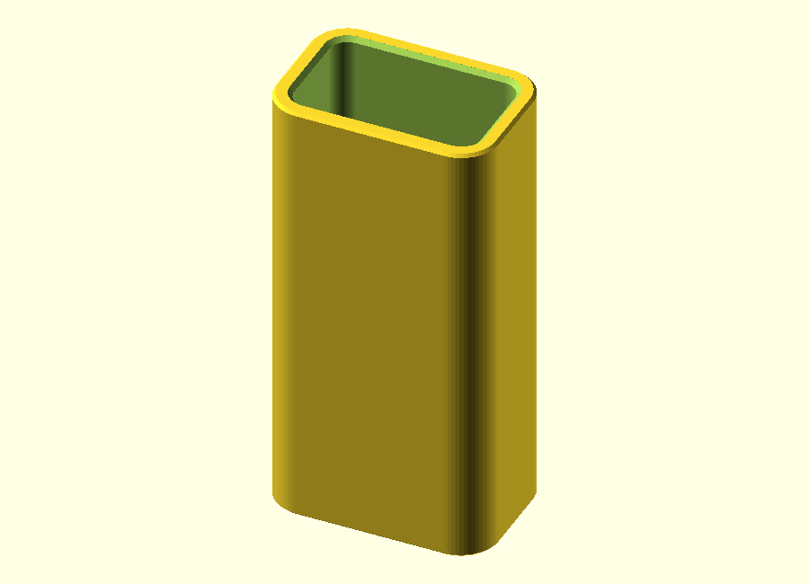
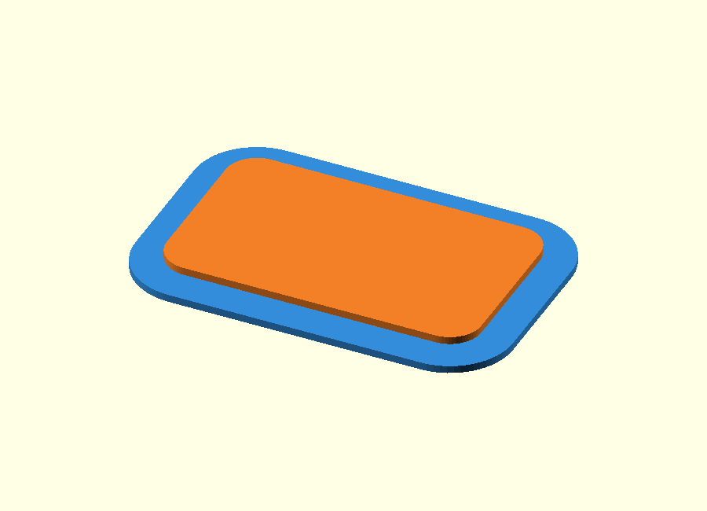
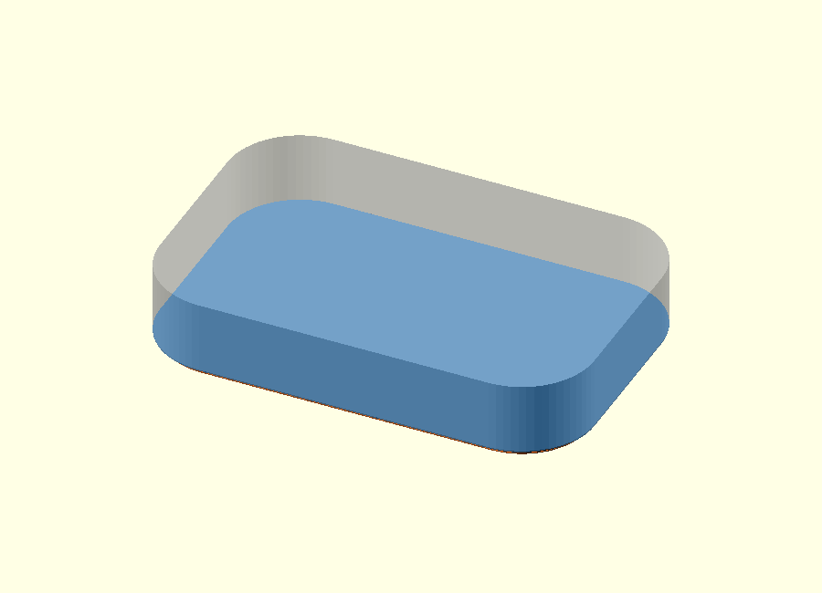
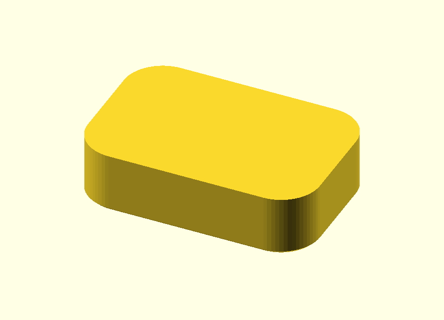
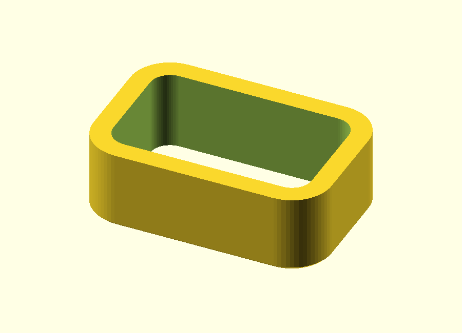
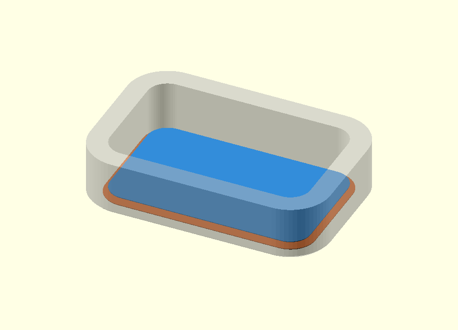
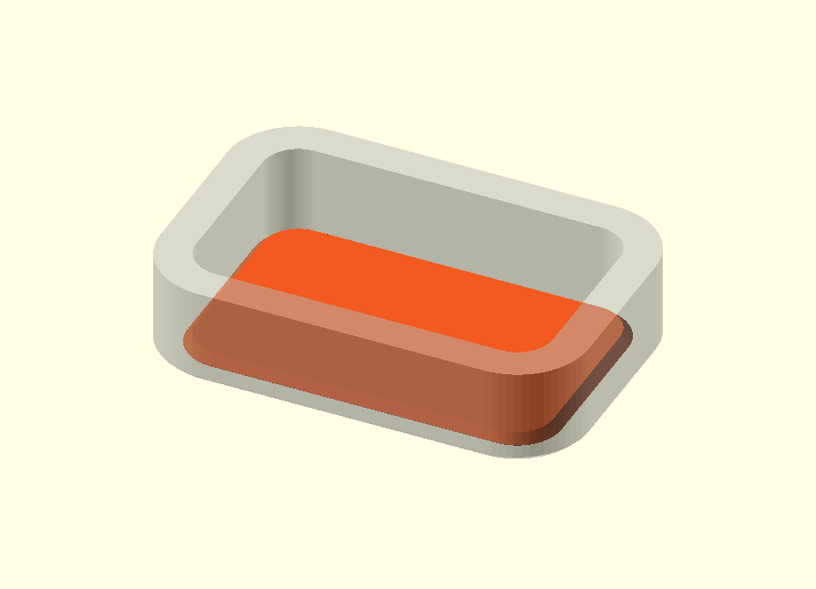
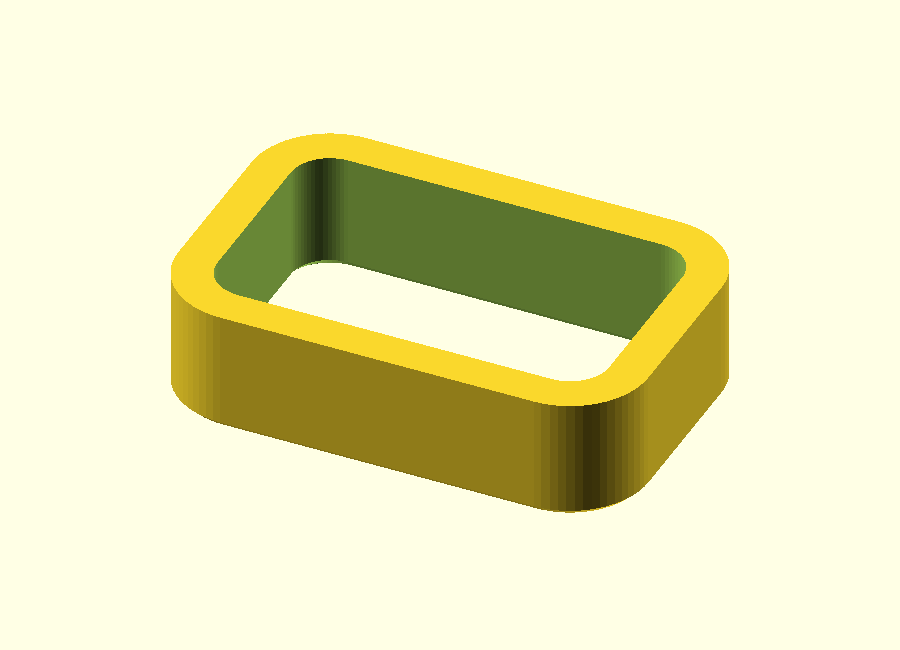
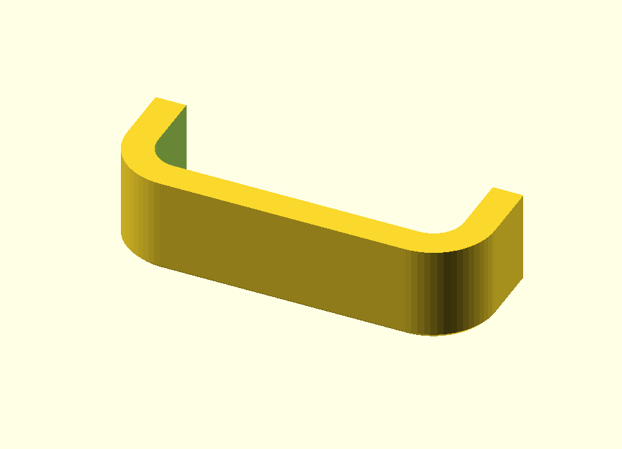

# Rounded rectangular tube with end chamfers — v0.1

This standalone OpenSCAD example builds a **hollow rounded rectangular tube** with two independently controlled end treatments:

- a small chamfer on the **outside edge** of both end faces;
- a separate chamfer on the **inside edge** of the hollow opening.

The interesting part is not the tube itself, but the construction method: the outside chamfer is created while building the solid outer body, while the inside chamfer is created later with a separate cutting volume.

## Files

- [Printable example](scad/rounded_rectangular_tube.scad)
- [Editable construction walkthrough](design/rounded_rectangular_tube_explained.scad)

The walkthrough has a `design_step` selector and exposes every important intermediate shape.

## Parameters

| Parameter | Default | Meaning |
| --- | ---: | --- |
| `outer_width` | 30 mm | Outside size in X |
| `outer_depth` | 20 mm | Outside size in Y |
| `length` | 60 mm | Tube length in Z |
| `wall_thickness` | 2.5 mm | Nominal wall thickness |
| `outer_radius` | 5 mm | Outside corner radius |
| `inner_chamfer` | 0.6 mm | Chamfer on the hollow inside edge |
| `outer_chamfer` | 0.4 mm | Chamfer on the outside edge |

The inner dimensions are derived from the outside dimensions:

~~~openscad
inner_width  = outer_width - 2 * wall_thickness;
inner_depth  = outer_depth - 2 * wall_thickness;
inner_radius = max(outer_radius - wall_thickness, 0.01);
~~~

## Construction at a glance

The model is easiest to understand as three operations:

~~~text
1. build chamfered outer solid
                ↓
2. subtract normal through-hole
                ↓
3. subtract tapered inside-chamfer cutters
~~~

The outside and inside chamfers therefore do **not** come from one complicated operation.

## Step A — Build the rounded 2D profiles

The blue shape is the outside profile. The orange shape is the smaller inside profile.

Both use the same rounded-rectangle helper:

~~~openscad
module rounded_rectangle(width, depth, radius) {
    hull()
        for (x = [radius, width - radius],
             y = [radius, depth - radius])
            translate([x, y])
                circle(radius);
}
~~~

Four circles define the corner radii. Because the desired outline is convex, `hull()` connects them with the straight sides of the rounded rectangle.

The inner profile is simply translated inward by the wall thickness:

~~~openscad
module inner_2d() {
    translate([wall_thickness, wall_thickness])
        rounded_rectangle(inner_width, inner_depth, inner_radius);
}
~~~

## Step B — Define the outside chamfer with two nearby profiles

At the physical end face, the outside profile is made slightly smaller with:

~~~openscad
offset(delta = -outer_chamfer)
    outer_2d();
~~~

Only `outer_chamfer = 0.4 mm` farther into the tube, the full outside profile is restored.

So the lower end is defined by:

~~~text
Z = 0.0 mm   smaller outside profile
Z = 0.4 mm   normal outside profile
~~~

The orange layer in the image is the smaller end profile. The blue layer is the normal profile.

## Step C — Hull the outside profiles

`hull()` connects the smaller end profile to the normal profile and creates the sloped outside face.

The real outer body does the same thing at both ends:

~~~openscad
module outer_body() {
    hull() {
        translate([0, 0, 0])
            linear_extrude(epsilon)
                offset(delta = -outer_chamfer)
                    outer_2d();

        translate([0, 0, outer_chamfer])
            linear_extrude(length - 2 * outer_chamfer)
                outer_2d();

        translate([0, 0, length - epsilon])
            linear_extrude(epsilon)
                offset(delta = -outer_chamfer)
                    outer_2d();
    }
}
~~~

The large middle extrusion is important: it keeps the full outside dimensions over almost the complete tube length. Only the short regions near the two end faces slope inward.

## Step D — Subtract the normal hollow interior

The outer body is still solid. The normal inner profile is therefore extruded completely through it:

~~~openscad
translate([0, 0, -1])
    linear_extrude(length + 2)
        inner_2d();
~~~

Subtracting that volume creates the tube wall.

At this stage:

- the outside end edge already has its chamfer;
- the inside end edge is still sharp.

## Step E — Define the inside chamfer with two opening sizes

The inside chamfer uses the opposite geometric idea.

At the end face, the hollow opening is made **larger**:

~~~openscad
offset(r = inner_chamfer)
    inner_2d();
~~~

At `Z = inner_chamfer = 0.6 mm`, the opening has returned to its normal size.

So the two important layers are:

~~~text
Z = 0.0 mm   enlarged inner opening
Z = 0.6 mm   normal inner opening
~~~

These layers do not describe material that will remain. They describe a cutter.

## Step F — Create the inside chamfer as a cutting volume

The two inner profiles are joined with another `hull()`:

~~~openscad
module inner_chamfer_cut() {
    hull() {
        translate([0, 0, -epsilon])
            linear_extrude(2 * epsilon)
                offset(r = inner_chamfer)
                    inner_2d();

        translate([0, 0, inner_chamfer])
            linear_extrude(epsilon)
                inner_2d();
    }
}
~~~

This creates a **solid tapered cutting volume**.

Most of that cutter lies inside the normal hollow space, where there is already no material. Only the slightly enlarged outer rim overlaps the tube wall. That overlapping rim is the material that will actually be removed.

This is why the cutter can be simple even though only a narrow chamfer is visible in the final part.

## Step G — Subtract the lower inside-chamfer cutter

Subtracting the tapered cutter removes the sharp inside edge.

The result now has two independent slopes at the lower end:

- outside profile: slopes **inward** toward the end face;
- inside opening: slopes **outward** toward the end face.

The wall between the two remains.

## Step H — Mirror the inside cutter at the top

The same cutter is mirrored around the top end:

~~~openscad
translate([0, 0, length])
    mirror([0, 0, 1])
        inner_chamfer_cut();
~~~

No second inside-chamfer implementation is needed.

The outside body was already symmetrical because its single `hull()` contains an inset profile at both ends.

## Step I — Inspect both chamfers in a cutaway

This view keeps only the lowest 8 mm and half the tube depth.

It exposes the finished relationship between:

- `outer_chamfer`;
- `inner_chamfer`;
- `wall_thickness`.

This is the most useful inspection view when changing those three values, because the full tube no longer hides the small end details.

## Why the chamfer construction stays simple

The finished tube is hollow, but the construction never asks one `hull()` to create the complete shell.

Instead, it separates the problem into two simple convex profile transitions:

~~~text
OUTSIDE BODY

smaller rounded outer profile
             ↓
           hull
             ↓
normal rounded outer profile

INSIDE CUTTER

larger rounded inner opening
             ↓
           hull
             ↓
normal rounded inner opening
             ↓
subtract
~~~

Each `hull()` therefore connects two related rounded rectangles.

The shell itself is therefore not created by one complicated hull. It is built as a solid outer body first and hollowed afterward. The inside chamfer is then a separate subtractive operation.

That separation is the main design idea in this example.

## Why `epsilon` exists

The helper layers use:

~~~openscad
epsilon = 0.01;
~~~

A `hull()` needs actual geometry, so the profile layers are given a very small thickness instead of being perfectly zero-thickness surfaces.

The cutters are also allowed to extend very slightly beyond an end face. This avoids relying on exactly coincident Boolean faces.

`epsilon` is a CAD construction tolerance. It is **not** a printing clearance or dimensional fit allowance.

## Complete final construction

After the helper modules have been defined, the finished tube is only:

~~~openscad
module rounded_rectangular_tube() {
    difference() {
        outer_body();

        // Continuous hollow interior.
        translate([0, 0, -1])
            linear_extrude(length + 2)
                inner_2d();

        // Inside chamfer at the bottom.
        inner_chamfer_cut();

        // Same inside chamfer at the top.
        translate([0, 0, length])
            mirror([0, 0, 1])
                inner_chamfer_cut();
    }
}
~~~

The complete editable source remains deliberately small; the separate design file exists only to make every intermediate construction step visible.
