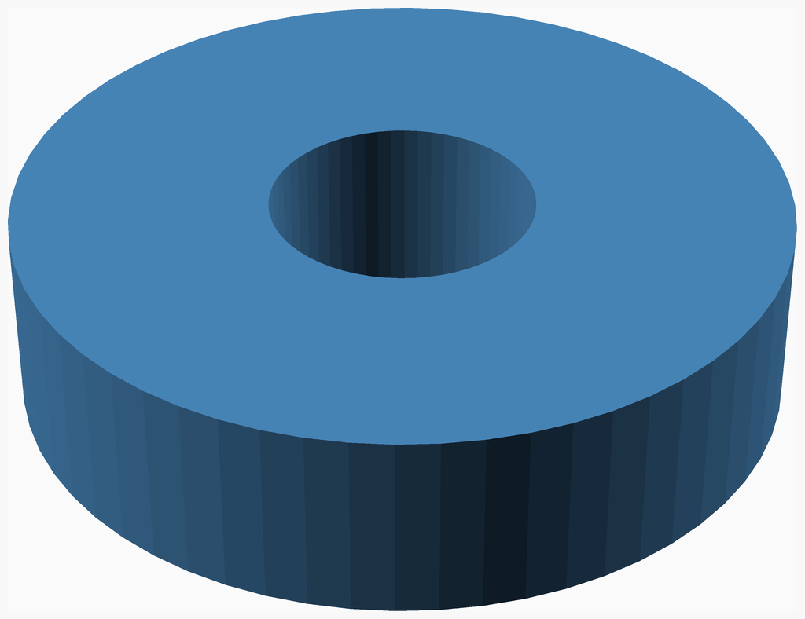
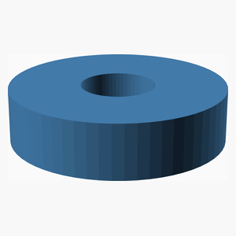
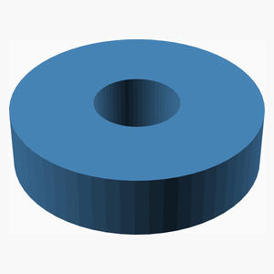

# V0.1
# Example spacer — v0.1

Minimal NopSCADlib project used to qualify this archive's workflow.
This is a demonstration, **not** an archived production model.

Parameters are in millimetres. The model is a 24 mm diameter spacer with
an 8.2 mm clearance bore and 6 mm height.

For printing, place the flat face on the bed. Material and dimensional
tolerances must be selected for the real application.

---
## Table of Contents
1. [Parts list](#Parts_list)
1. [Main Assembly](#main_assembly)

[Top](#TOP)

---

## Parts list
| Main | TOTALS |  |
|---:|---:|:---|
|  | | **3D printed parts** |
| &nbsp;&nbsp;1&nbsp; |  &nbsp;&nbsp;1&nbsp; | &nbsp;&nbsp;spacer.stl |
| &nbsp;&nbsp;1&nbsp; | &nbsp;&nbsp;1&nbsp; | &nbsp;&nbsp;Total 3D printed parts count |

[Top](#TOP)

---

## Main Assembly
### 3D Printed parts

| 1 x [spacer.stl](stls/spacer.stl) |
|---|
|  

### Assembly instructions

Place the printed spacer on a flat surface.

[Top](#TOP)
