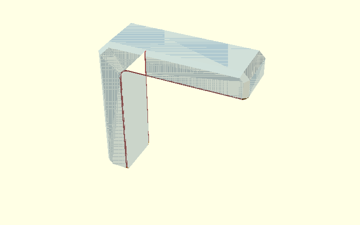

# Chamfers and print relief on the Corner Bracket

This guide follows the simplified `corner_bracket.scad` model.

| Setting | What changes | How it is made |
| --- | --- | --- |
| `arm_end_chamfer` | outer ends of both arms | coordinates in the 2D profile |
| `outer_corner_chamfer` | large outside corner | coordinates in the 2D profile |
| `side_edge_chamfer` | long outside edges on both broad faces | `hull()` keep envelope + `intersection()` |
| `elephant_foot_relief` | plywood-facing print edges | one continuous opening hull per broad side + tiny arm-tip correction |

For the general **keep / cut / clip** vocabulary, see [OpenSCAD design concepts](../../../docs/design-concepts.html).

The editable walkthrough is [chamfer_explained.scad](../design/chamfer_explained.scad).

## 1. Start with a plain L

## 2. Put simple chamfers directly in the 2D profile

The arm-end chamfers and large outside corner chamfer are points in `base_profile_2d()`.

The rounded inside corner is added with `inside_corner_fill_2d()`.

The tiny elephant-foot bevel on the two arm **end faces** also stays in this 2D profile. That avoids another pair of 3D cutters.

## 3. Extrude the profile

`profile_body()` gives the finished 2D outline its full `bracket_width`.

## 4. Make a temporary convex outside outline

The real L is concave. A global hull would bridge its open inside corner.

So `outer_chamfer_envelope_2d()` intentionally describes only the outside envelope.

## 5. Make the two outside-chamfer inputs

One profile keeps the full perimeter but is narrower than the bracket. The other reaches full width but is inset by `side_edge_chamfer`.

## 6. Connect those inputs with hull()

`outer_side_chamfer_keep_envelope()` creates the sloped outside volume that is allowed to remain.

## 7. Clip that envelope with the real L

~~~openscad
module outer_side_chamfered_body() {
    if (side_edge_chamfer > 0)
        intersection() {
            profile_body();
            outer_side_chamfer_keep_envelope();
        }
    else
        profile_body();
}
~~~

The hull creates the slope; the intersection only clips it back to the real L.

## 8. One continuous elephant-foot relief per broad side

This is the important simplification.

The model does **not** build separate straight cutters for the horizontal edge, rounded corner and vertical edge.

`inside_opening_2d()` describes the complete open region once.

`inside_side_relief_cuts()` connects a normal opening layer to an enlarged opening layer at each printable side face:

~~~openscad
module inside_side_relief_cuts() {
    if (elephant_foot_relief > 0)
        for (side = [-1, 1])
            hull() {
                inside_side_relief_layer(
                    side * (bracket_width / 2 - elephant_foot_relief)
                );
                inside_side_relief_layer(
                    side * bracket_width / 2,
                    elephant_foot_relief
                );
            }
}
~~~

Each hull therefore handles one complete path:

~~~text
horizontal plywood-facing edge
             ↓
rounded inside corner
             ↓
vertical plywood-facing edge
~~~

There are two hulls only because either broad face can be the print face.

### The only separate 3D correction: the arm tips

Where the continuous side relief reaches the diagonal outside side chamfer, a tiny local wedge is needed.

The old implementation used a general `multmatrix()` coordinate frame. For these two fixed 45-degree junctions that was harder to read than necessary.

The current helper is only an extruded triangle:

~~~openscad
module arm_tip_relief_wedge(length) {
    linear_extrude(height = length)
        polygon([
            [-elephant_foot_relief - 1, -1],
            [1, -1],
            [1, elephant_foot_relief + 1]
        ]);
}
~~~

It is placed with ordinary rotations:

- horizontal arm: `rotate([90, 0, 45])`;
- vertical arm: `rotate([0, 45, 90])`;
- the other broad side is obtained with `mirror()`.

No general transformation matrix is needed.

## 9. Subtract the relief

~~~openscad
module print_compensated_body() {
    difference() {
        outer_side_chamfered_body();
        inside_side_relief_cuts();
        arm_tip_relief_cuts();
    }
}
~~~

So the 3D print compensation has only two conceptual pieces: the continuous main side relief and the small local arm-tip correction.

## 10. Final bracket

The final operation removes four countersunk M5 bolt paths:

~~~openscad
module bracket() {
    difference() {
        print_compensated_body();
        bolt_cuts();
    }
}
~~~

The bolt geometry is independent from the chamfer construction.
