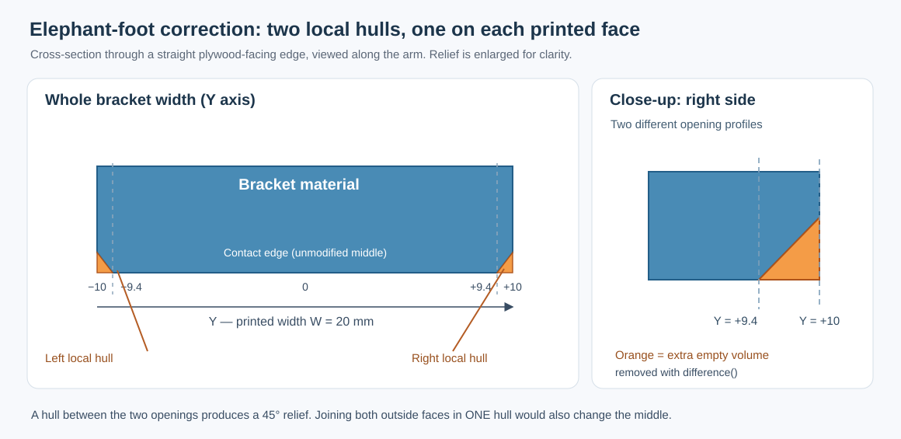
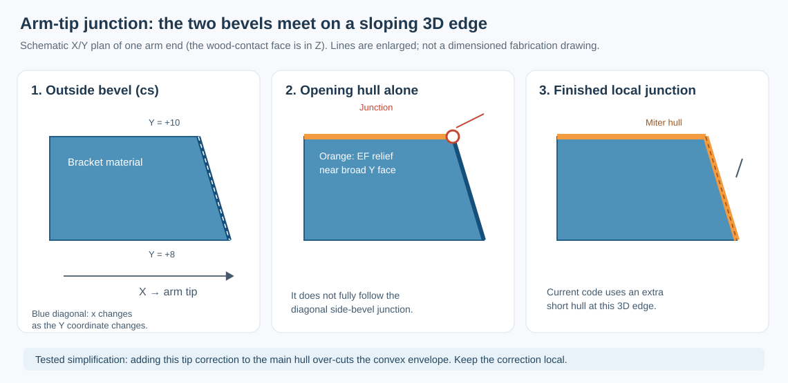

# Chamfers on the Corner Bracket

This is the **one detailed walkthrough** of chamfers in the *actual*
[Corner Bracket model](../scad/corner_bracket.scad). It follows the
construction order: **complete 2D polygon → rounded inside corner → 3D
body → outside chamfers → elephant-foot relief → corner junctions**.

The [Polygon Guide](polygon-guide.html) explains *how* the inside radius
is built. The [Hull Guide](hull-guide.html) teaches the general
`hull()` operation with a simple rectangular bar. **This page is where
those ideas are applied to the real bracket.**

| Parameter | Default | Purpose |
| --- | ---: | --- |
| `c` | 3 mm | 45° cuts at the two arm ends, part of the original polygon |
| `ce` | 6 mm | 45° cut at the outside corner, also part of the polygon |
| `cs` | 2 mm | Bevel along the outside edges of the two broad printed faces |
| `ef` | 0.6 mm | Print-bed relief along the plywood contact edges, on both printed faces |
| `r_in` | 2 mm | Rounded *inside* corner of the L; not an edge chamfer |

## 1. The actual profile is already a complete polygon

There is **no preliminary, plain L polygon in the production model**.
`sharp_profile()` defines the *entire* outline of the bracket,
including the outer corner (`ce`), both arm-end chamfers (`c`) and
the short `ef` bevels at the wood-facing arm tips.


The critical points are already in that one `polygon()`:

```openscad
module sharp_profile() {
    polygon(concat(tip_top, [
        [armH, t - c], [armH - c, t], // top arm end, c
        [-t + ce, t], [-t, t - ce],  // outer corner, ce
        [-t, -armV + c], [-t + c, -armV] // upright arm end, c
    ], tip_vert, [[0, 0]]));
}
```

The name `sharp_profile()` only means that its **inside corner**
at `[0,0]` is still sharp. It does **not** mean that its arm
ends or outside corner are unchamfered.

`profile()` then makes **one addition** to this complete polygon:
the small inside fillet made by `inside_corner_2d(r_in)`, using a
2D square minus a circle. That fillet is added with `union()`.
See the [Polygon Guide](polygon-guide.html) for its construction.

Finally, `linear_extrude(height = W, center = true)` and
`rotate([90,0,0])` turn this profile into a 20 mm-wide solid:
its broad printed faces lie at **Y = −10 and +10 mm**.


## 2. Outside side-edge chamfers: `cs`

The `c` and `ce` cuts above were drawn in **2D**. The outer
side-edge bevel `cs` is different: it changes the **3D thickness
edges** near Y = ±10.

The model constructs a temporary **convex outer envelope**,
`outer_shape()`. It *deliberately fills the open inside of the L*,
because this is only a helper for the outside edges.

Two overlapping solids form the input to `hull()`:

| First input | Second input |
| --- | --- |
| Full outside outline | Outline inset using `offset(delta = -cs)` |
| Width `W - 2*cs = 16` mm | Full width `W = 20` mm |
| Y from −8 to +8 mm | Y from −10 to +10 mm |


```openscad
module side_chamfer_env() {
    rotate([90,0,0]) hull() {
        linear_extrude(height=W-2*cs, center=true)
            outer_shape();                   // full outline, narrow Y
        linear_extrude(height=W, center=true)
            offset(delta=-cs) outer_shape(); // inset outline, full Y
    }
}
```

The outer boundary moves inward by **2 mm** between Y = ±8
and Y = ±10. `hull()` joins these boundaries with sloping
faces. The resulting helper is still convex and fills the L opening.

The **next operation is essential**:
`intersection()` with the true extruded `profile()` removes
the unwanted convex fill. Only the real L with its outside
side-edge bevels remains.


## 3. Elephant-foot relief: what goes into its `hull()`?

**Printing orientation matters:** the bracket rests on a broad
Y-facing side during printing. Slight first-layer expansion can
interfere with the plywood-facing surfaces. Here `ef=0.6` mm
provides clearance near *both* Y side faces.

Rather than offsetting the *solid bracket*, the model starts
with the **empty space between the two arms**:

```openscad
module inside_opening_2d() {
    reach = max(5, cs + ef + 1);
    difference() {
        translate([0, -armV - reach])
            square([armH + reach, armV + reach]);
        if (r_in > 0) inside_corner_2d(r_in);
    }
}
```

That cutting opening has straight boundaries along the
plywood-contact faces and a curved boundary at the inside radius.
Its ends extend *beyond* the arms to avoid artificial end caps.

For **one printed side**, two *very thin* 3D copies of this
opening are made:

| Location | Input to `hull()` | Effect |
| --- | --- | --- |
| Y = +9.4 mm | Original opening | No print relief in the middle |
| Y = +10 mm | Opening expanded by `offset(delta=0.6)` | Room for first-layer bulging |

At the other printed side the same pair appears at
**Y = −9.4 mm** and **Y = −10 mm**.



```openscad
module opening_layer(y, expansion=0) {
    translate([0,y,0])
        rotate([90,0,0])
            linear_extrude(height=0.002, center=true)
                offset(delta=expansion)
                    inside_opening_2d();
}

module inside_relief_envelope() {
    if (ef > 0)
        for (side=[-1,1])
            hull() {
                opening_layer(side*(W/2-ef)); // unchanged opening
                opening_layer(side*W/2, ef);   // expanded opening
            }
}
```

Each `hull()` joins a normal opening to a slightly expanded one.
**Subtracting** this volume from `body()` creates the 45°
relief along the straight contact faces *and* the rounded inside
corner. The 0.002 mm layer thickness is a modelling tolerance,
not the specified relief depth.

Why not one hull connecting **all four** slices? That would put
both enlarged outside outlines in a *single convex envelope* and
enlarge the opening throughout the width, including the
undisturbed middle. Thus, the model uses **one local hull per side**.

## 4. Where the two kinds of bevel meet

There is one further detail. At each arm end, the `ef` relief
meets the **diagonal `cs` side-edge bevel**. The two opening
profiles above describe the plywood contact faces and the inner
radius, but **not** the entire slanted edge at this junction.
Using only those profiles leaves a small flat termination.

The current production model fills this gap with
`relief_corner_miters()`: short local hulls of triangular
cutting profiles following the diagonal end of each `cs` bevel.
Both arm ends and both printed sides are covered.



The current assembly is therefore:

```openscad
module chamfered_body() {
    difference() {
        body();                     // outer cs hull + true L
        if (ef > 0) {
            inside_relief_envelope(); // two hulls: wood contact + radius
            relief_corner_miters();   // local hulls: diagonal tip joins
        }
    }
}
```

The additional cutter is **not a smoothing or mesh post-process**:
it is ordinary OpenSCAD geometry subtracted in the *same*
`difference()` operation.

### Could this be one better-prepared hull instead?

**That is a sensible design alternative.** If the side-edge
junctions are encoded correctly in the input profiles *before*
`hull()`, a separate set of tip cutters might be unnecessary.

However, simply cutting corners from the existing 2D
`inside_opening_2d()` is **not yet proven** to reproduce the
full 3D junction: the affected end edge also slopes through
**Y** because of `cs`. And `hull()` replaces nonconvex
details by their convex envelope. A carefully segmented profile
construction or extra intermediate sections may be needed.

**Current status:** the single-profile idea has **not** been
implemented or validated on the full bracket. The production
model still uses the extra local hull cutters. The proposed
refactor should be compared at the four individual corners,
not merely by total bracket volume.

## 5. What is checked, and what is not

The CI test `verify-elephant-foot-hull.sh` compares the
complete bracket with the former per-edge cutter implementation,
including its mounting holes. A second check isolates the
four arm-tip junctions. Both tests passed for the supported
parameter combinations in PR #10.

The geometry has **not** yet been physically test-printed;
clearance, strength and the visual quality of every bevel
still need checking.

For a first introduction to `hull()`, continue with the
[short Hull Guide](hull-guide.html). For the mathematical
construction of the inside radius, use the
[Polygon Guide](polygon-guide.html).
