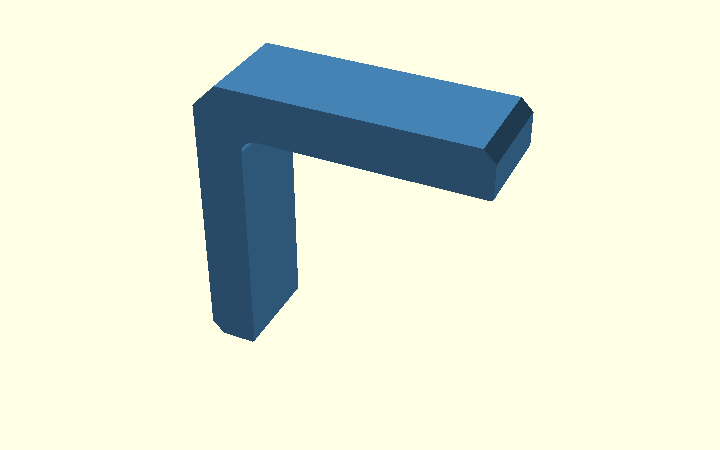
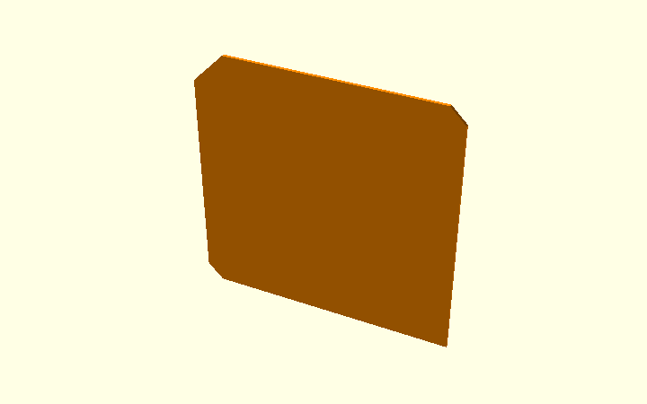
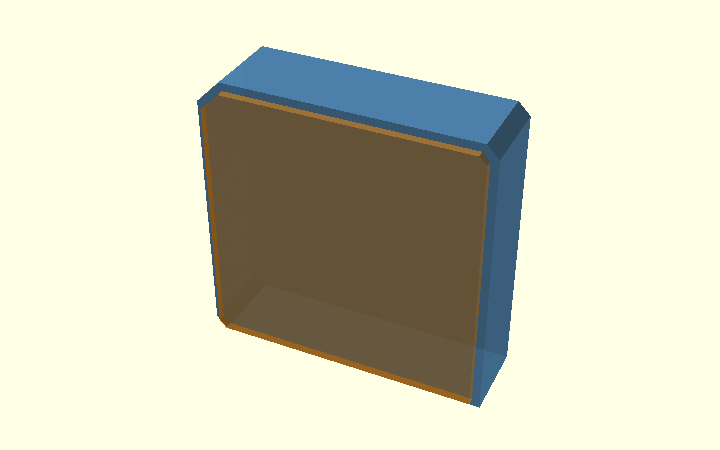
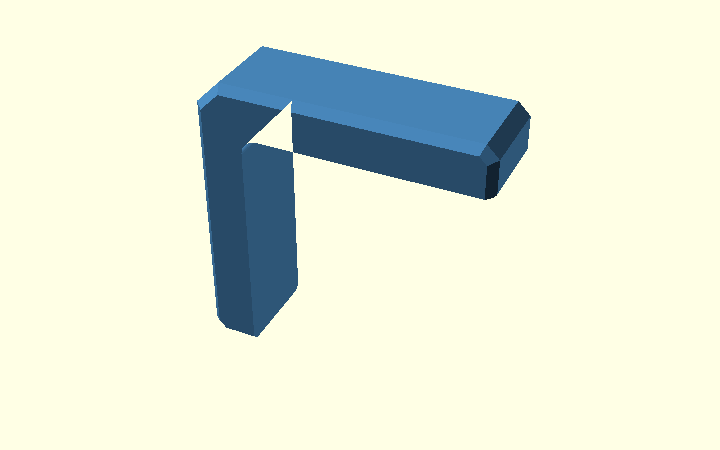
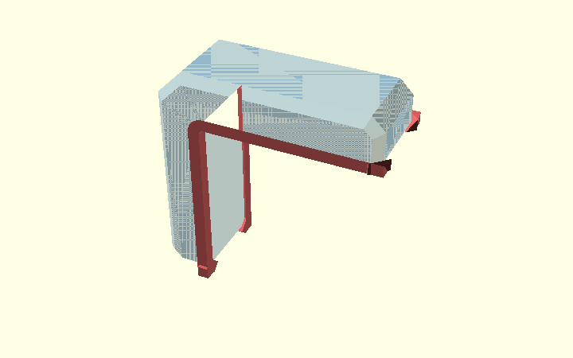
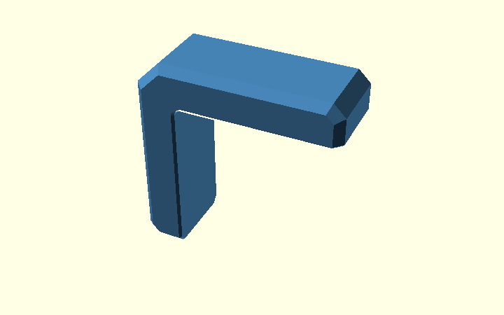
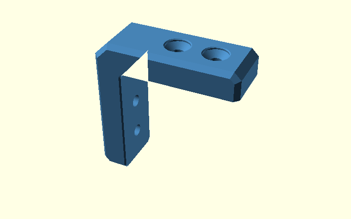

# Chamfers and print relief on the Corner Bracket

This guide follows the actual `corner_bracket.scad` model.

The main point is that the bracket has **three different edge treatments**, and they are not all made the same way.

| Setting | What changes | How it is made |
| --- | --- | --- |
| `arm_end_chamfer` | ends of both arms | coordinates in the 2D profile |
| `outer_corner_chamfer` | large outside corner | coordinates in the 2D profile |
| `side_edge_chamfer` | long outer edges on both broad side faces | `hull()` creates a keep envelope, then `intersection()` clips it to the real L |
| `elephant_foot_relief` | small print-facing contact edges | explicit cutter volumes removed with `difference()` |

For the general idea behind **keep**, **cut** and **clip** geometry, see the archive-wide [OpenSCAD design concepts](../../../docs/design-concepts.html).

The editable walkthrough is [chamfer_explained.scad](../design/chamfer_explained.scad). Select `chamfer_step` in the OpenSCAD Customizer to view the same ten stages.

## 1. Start with a plain L

This is only a teaching reference. It has no rounded inside corner and no chamfers yet.

The real model does not print this shape; it is just useful for seeing what changes next.

## 2. Put the simple chamfers directly in the 2D profile

Two edge treatments are easiest to draw directly:

- `arm_end_chamfer` cuts both arm ends;
- `outer_corner_chamfer` cuts the large outside corner.

Those are simply coordinates in `base_profile_2d()`.

The rounded inside corner is added separately with `inside_corner_fill_2d()`.

Conceptually:

~~~openscad
module bracket_profile_2d() {
    union() {
        base_profile_2d();

        if (inside_corner_radius > 0)
            inside_corner_fill_2d(inside_corner_radius);
    }
}
~~~

There is no reason to use `hull()` or a 3D cutter for these features because the desired 2D outline is already easy to draw.

## 3. Extrude the finished profile

`profile_body()` gives the 2D profile its full `bracket_width`.

~~~openscad
module profile_body() {
    rotate([90, 0, 0])
        linear_extrude(height = bracket_width, center = true)
            bracket_profile_2d();
}
~~~

At this point the broad side-face edges are still square.

## 4. Make a temporary convex outside outline

The real bracket is concave: it has an open inside corner.

A global `hull()` of that L would bridge the opening. So the model first creates a separate helper called `outer_chamfer_envelope_2d()`.

This helper deliberately fills the opening. That is okay because it is **not** the final part. It exists only to describe the outside boundary.

## 5. Make the two inputs for the side chamfer

The blue input keeps the full outside outline but stops short of the two broad side faces.

The orange input reaches the full `bracket_width`, but its 2D outline is inset by `side_edge_chamfer`.

With the default values:

~~~text
middle of bracket:
full outside outline
Y = -8 .. +8 mm

outer side faces:
outline inset by 2 mm
Y = -10 .. +10 mm
~~~

Those two shapes describe the slope we want on the outside edges.

## 6. Connect those inputs with hull()

`outer_side_chamfer_keep_envelope()` connects the two helper solids:

~~~openscad
module outer_side_chamfer_keep_envelope() {
    rotate([90, 0, 0])
        hull() {
            linear_extrude(
                height = bracket_width - 2 * side_edge_chamfer,
                center = true
            )
                outer_chamfer_envelope_2d();

            linear_extrude(height = bracket_width, center = true)
                offset(delta = -side_edge_chamfer)
                    outer_chamfer_envelope_2d();
        }
}
~~~

The hull is **keep geometry**: it describes the maximum outer volume that is allowed to remain after the side chamfer.

But it is still convex, so its inside L opening is filled.

## 7. Clip the keep envelope with the real L

Now `intersection()` combines two things:

1. the real L-shaped `profile_body()`;
2. the convex side-chamfer keep envelope.

~~~openscad
module outer_side_chamfered_body() {
    intersection() {
        profile_body();

        if (side_edge_chamfer > 0)
            outer_side_chamfer_keep_envelope();
        else
            rotate([90, 0, 0])
                linear_extrude(height = bracket_width, center = true)
                    outer_chamfer_envelope_2d();
    }
}
~~~

This is an important distinction:

**`hull()` creates the sloped outside envelope. `intersection()` only clips that envelope back to the real L shape.**

The intersection is not a second chamfer operation.

## 8. Describe the elephant-foot relief as cutters

The print relief is a different problem.

Here it is easier to describe the tiny pieces of material that must disappear than to describe a new outside body.

So `elephant_foot_relief_cuts()` creates explicit removal volumes:

- a 45-degree cutter along the horizontal plywood-facing edge;
- a similar cutter along the vertical edge;
- a revolved cutter around the rounded inside corner;
- short diagonal cutters at the two arm ends where this relief meets `side_edge_chamfer`.

The same set is mirrored to both printable side faces.

These shapes are **cut geometry**. They are not part of the bracket.

## 9. Subtract the print-relief cutters

The production operation is now deliberately simple:

~~~openscad
module print_compensated_body() {
    difference() {
        outer_side_chamfered_body();
        elephant_foot_relief_cuts();
    }
}
~~~

This matches the physical intent exactly: first make the side-chamfered bracket, then remove the small amount of material needed for print compensation.

The previous production experiment used enlarged opening layers, local hulls and extra miter hulls. That approach is no longer in the printable model. It remains only in the regression fixture so CI can compare the two results.

## 10. Remove the fastener spaces

The last large geometry operation removes the captive-nut pockets, access windows and bolt paths:

~~~openscad
module bracket() {
    difference() {
        print_compensated_body();
        top_fastener_cut();
        vertical_fastener_cut();
    }
}
~~~

The names are intentional:

- `top_fastener_cut()` is material to remove from the top arm;
- `vertical_fastener_cut()` is material to remove from the vertical arm.

They are not nuts or bolts themselves.

## Why the production model uses two different approaches

The outside side chamfer is easy to describe as the shape that should **remain**, so a hull-generated keep envelope works well.

The elephant-foot compensation is easier to describe as the material that should **go away**, so direct cutters are clearer.

That is the useful rule to remember:

~~~text
easy to describe what remains -> build keep geometry

easy to describe what disappears -> build cut geometry

need an exact final boundary -> clip with intersection()
~~~

The modelling method follows the geometry; it does not need to be the same for every chamfer.

## Regression check

`tests/elephant-foot-equivalence.scad` setains the former hull-based print-relief implementation only as a comparison reference.

CI compares that former hull result with the current direct-cutter bracket across several values of:

- `side_edge_chamfer`;
- `elephant_foot_relief`;
- `inside_corner_radius`.

The accepted whole-part difference remains below the existing 0.1% tolerance, and the bounding box must stay unchanged.

This is a geometry regression check. Physical fit and strength still need real prints.
