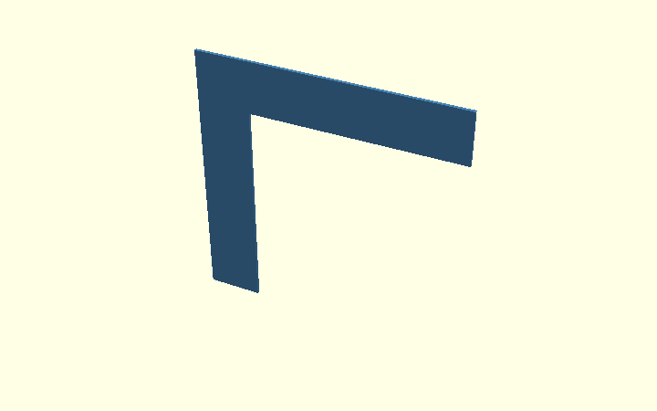
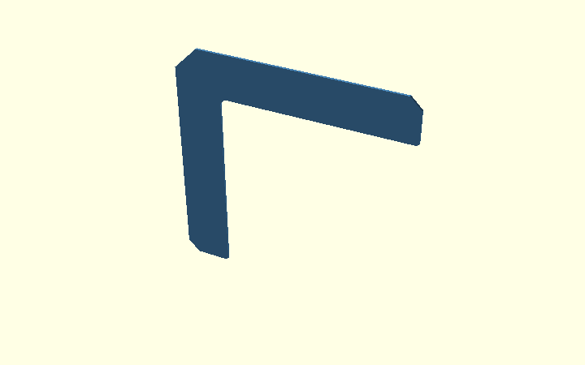
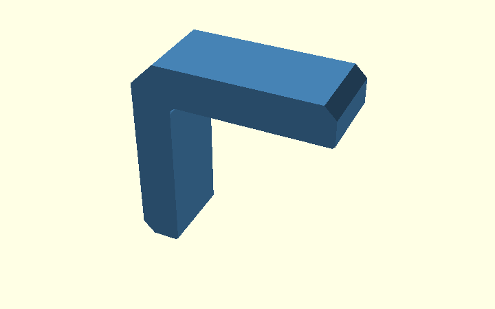
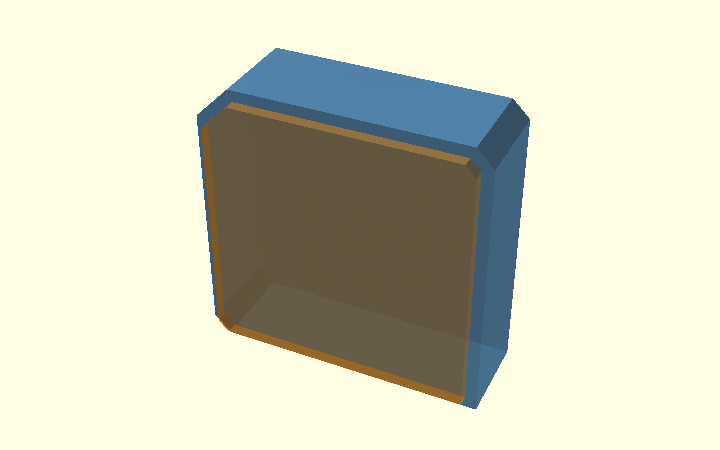
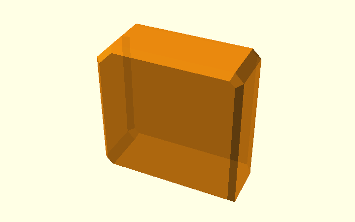
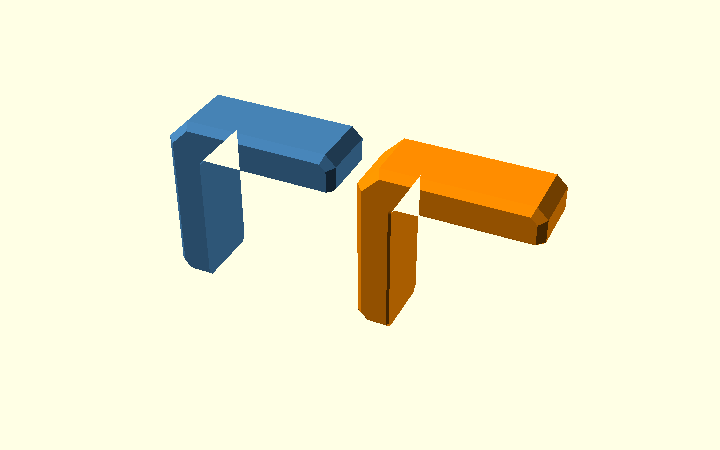
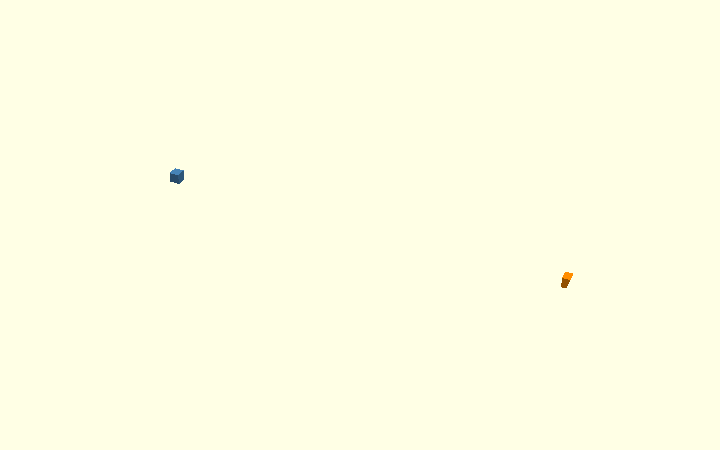
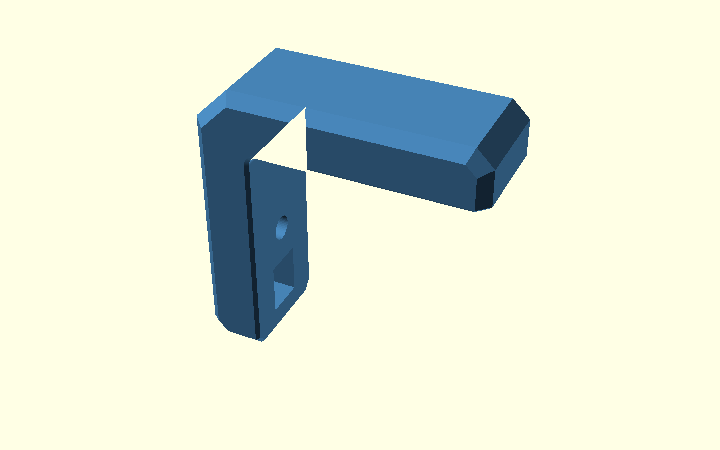

# Chamfers on the Corner Bracket — from 2D vertices to 3D relief

This guide follows the **actual v0.1 model**, with ten illustrations
generated from [chamfer_explained.scad](../design/chamfer_explained.scad).
You can open that file in OpenSCAD and select `chamfer_step` to inspect
each stage. The examples use the real model modules whenever possible.

Three different features are easily confused:

| Setting | Default | Which edge changes? | Operation |
| --- | ---: | --- | --- |
| `c` | 3 mm | Ends of both arms | Coordinates in the **2D polygon** |
| `ce` | 6 mm | Large outside corner joining the arms | Coordinates in the **2D polygon** |
| `cs` | 2 mm | Long outside edges of the printed *side faces* | `offset()` + `hull()` + `intersection()` |
| `ef` | 0.6 mm | Printed-side contact edges and junctions with the outer bevel | Two local opening hulls, plus small local correction hulls |

These operations run at different stages. `c` and `ce` are part of
the initial **profile**, `cs` changes the **3D side edges**, and
`ef` removes printing clearance near **both side faces**.

## 1. Begin with the plain L outline

An ordinary L-shaped `polygon()` starts with sharp ends and a sharp
outer corner. This is a **teaching reference**, not the final model.



## 2. Cut the arm ends and large outside corner in 2D

The production `sharp_profile()` draws the arm-end chamfers and the
large outside corner directly into the polygon. In the same 2D step,
`inside_corner_2d(r_in)` adds the separate **concave radius** using a
square-minus-circle shape. Its construction is explained in the
[Polygon Guide](polygon-guide.html).



The following **actual source coordinates** control the 45° cuts:

```openscad
[armH, t-c],       // one side of the top arm's end chamfer
[armH-c, t],       // other side: c mm back
[-t+ce, t],       // first point at the large outside corner
[-t, t-ce],       // second point: ce mm down
[-t, -armV+c],    // vertical arm-end chamfer
[-t+c, -armV]     // second point at that end
```

For the defaults, `c = 3` means a 3 × 3 mm 45° cut at each
arm end. Likewise, `ce = 6` creates a 6 × 6 mm 45° cut across
the large outside corner. No `hull()` is involved here.
The tiny `ef` corrections at the *wood-facing arm tips* are
also represented by the `tip_top`/`tip_vert` point lists.
They are distinct from these larger cuts.

## 3. Extrude the finished profile across the width

The rounded L becomes a **20 mm wide solid** through
`linear_extrude(height = W, center = true)`. Rotation puts the
width along the Y axis, so the broad side faces are at
`Y = -10` and `Y = +10`.



```openscad
rotate([90,0,0])
    linear_extrude(height=W, center=true)
        profile();
```

The side-face edges are still square. We now create the **2 mm bevel**
along those outside edges.

## 4. Why make a convex outer outline?

The temporary `outer_shape()` contains the entire outside perimeter
of the bracket but fills the open space between its arms. This may
look wrong, but the helper is **not** intended for printing.


An `offset()` applied directly to the original L would also change
its concave inside corner and the plywood contact region. Instead, we
use the *outer* envelope solely to restrict the outside edges, then
recover the original L by intersection.

## 5. Prepare the two inputs to hull()

The blue extrusion keeps the **full outside outline**, but is only
`W-2*cs = 16` mm wide: `Y = -8 ... +8`.

The orange extrusion extends across the **full 20 mm width**,
but `offset(delta=-cs)` makes its X/Z outline **2 mm smaller**
all around. Its outer faces are at `Y = -10` and `Y = +10`.



```openscad
rotate([90,0,0]) {
    // Full outline, narrower Y range
    linear_extrude(height=W-2*cs, center=true)
        outer_shape();
    // Inset outline, full Y range
    linear_extrude(height=W, center=true)
        offset(delta=-cs) outer_shape();
}
```

This is different from two stacked flat plates: the **two extrusions
overlap** in the centre and have different side-face extents.

## 6. Hull joins the two outside envelopes

`hull()` wraps both extrusions and connects their outer boundaries.
From the unchanged middle at `Y = ±8` to the smaller outline at
`Y = ±10`, it produces a sloping 2 mm side-edge transition.



```openscad
rotate([90,0,0]) hull() {
    linear_extrude(height=W-2*cs, center=true)
        outer_shape();
    linear_extrude(height=W, center=true)
        offset(delta=-cs) outer_shape();
}
```

The envelope is convex, so the **inside of the L is filled in**.
This is expected and still not a printable part.

## 7. Intersect the hull with the real L

`intersection()` keeps only the material shared by the true
extruded L and the chamfer envelope. This removes the unwanted
filled-in region and retains the actual concave inside radius.


```openscad
intersection() {
    profile_extrusion();
    side_chamfer_env();
}
```

This is the role of `body()` in the model. Changing `cs` changes
the side-edge bevel; it does **not** replace the profile's `c`,
`ce` or `r_in`.

## 8. Apply hull-based elephant-foot relief

The bracket rests on a **side face** while printing. Bulging first
layers could prevent the L's inner surfaces from seating against the
plywood. The parameter `ef = 0.6` mm removes material near the
wood-facing edges at `Y = -10` and `Y = +10`.

**Left:** `body()` with only the outer side-edge bevels.
**Right:** `chamfered_body()` after the new inner-opening relief
has been subtracted. Neither has nut holes yet.



Instead of moving separate triangular cutters along each line and
revolving another cutter around the arc, the production code:

1. Builds the empty area between the arms with
   `inside_opening_2d()`. This **convex opening** has a straight
   boundary along both plywood faces and a circular inner transition.
2. At `Y = ±9.4`, uses that original 2D opening; at `Y = ±10`,
   expands it by 0.6 mm with `offset(delta=ef)`.
3. Uses **one local hull per side** to connect those two profiles.
4. Adds **two more short hulls per printed side** where the relief meets
   the diagonal `cs` bevels at the arm ends. Those junctions otherwise
   leave a visible flat termination at the corner.
5. Subtracts the opening hulls and local correction hulls from the outside-chamfered
   body with `difference()`.

Why not just one hull from one printed side to the other? A global
convex hull would bridge **both expanded ends**, enlarging the opening
through the whole central width. Two local hulls avoid that mistake.

```openscad
module chamfered_body() {
    difference() {
        body();                      // outside: cs hull bevel
        if (ef > 0) {
            inside_relief_envelope(); // inner plywood-facing edges
            relief_corner_miters();  // diagonal arm-tip junctions
        }
    }
}
```

### Close-up: the corner where two chamfers meet

The broad inner-opening hulls by themselves leave a small unwanted
termination where the elephant-foot allowance meets a diagonal outer
side-edge bevel. This is hard to see in a full model view and barely
changes the overall mesh volume. A separate **small triangular profile**
gets swept along each local diagonal with `hull()`.



**Left:** inner-opening hulls only. **Middle:** isolated small diagonal
correction volume. **Right:** both the opening relief and local correction applied. The
figure crops the horizontal arm-tip corner for inspection; the production
model also handles the opposite side and the other arm.

A dedicated CI test clips the **symmetric difference** with the former
model to just these four junctions. It verifies that adding the
local correction removes at least 90% of the local defect volume across the
supported nonzero `cs`/`ef` combinations. This supplements the
whole-model 0.1% volume tolerance.

The diagrams locate the small 45-degree contact-edge relief:


## 9. Final bracket and regression checks

The final `bracket()` removes the nut access windows and bolt holes
from `chamfered_body()`.



The earlier [single-hull straight-bar experiment](hull-guide.html#4-earlier-single-hull-experiment-on-a-straight-bar)
is still documented, but the **actual L bracket has now changed**:
the old `ef_cuts()` wedges were removed. A regression test compares
the complete new and old solids at several `cs`, `ef` and `r_in`
settings. Expect small differences at intersections of the old
individual cutters; the new construction is an intentional geometric
refactor, **not a physical fit or strength verification**.

For the mathematical principle and its rectangular-bar introduction,
see the separate [Hull Guide](hull-guide.html).
