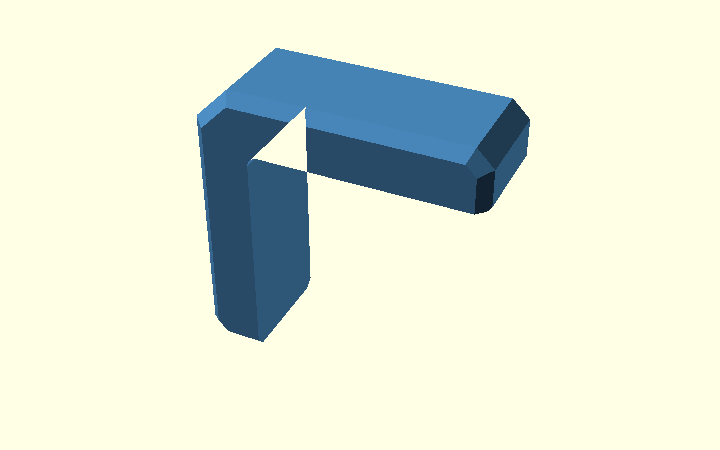
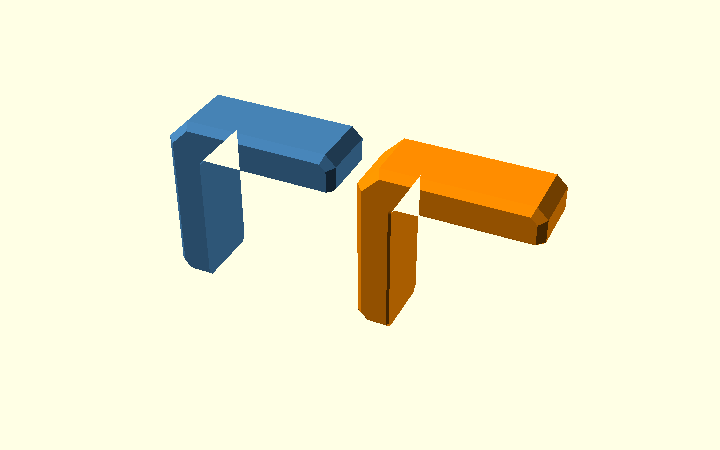
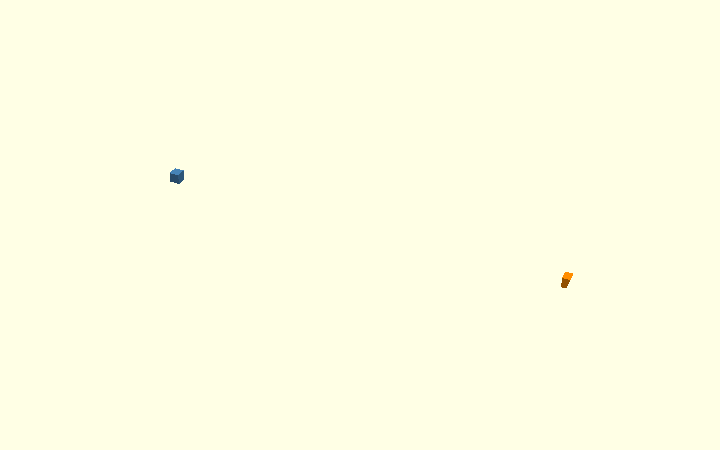

# Corner Bracket: `cs` and `ef` — explained from the actual model

This page explains the **current production solution** in
[`corner_bracket.scad`](../scad/corner_bracket.scad).

It is intentionally not another experiment. The goal is to make the existing
geometry understandable before changing it again.

## The short version

There are two different operations:

1. **`cs`** makes the long outside side-edge chamfers.
2. **`ef`** removes a small amount of material along the complete inside L:
   horizontal contact face → rounded inside corner → vertical contact face.

The normal `ef` relief already works along almost the complete L.

There is only one awkward place: **at each arm tip, the `ef` relief meets the
diagonal `cs` chamfer**. The production model adds a very small local
`hull()` there to make that junction continue cleanly.

That is why the current solution has two parts:

```text
main ef relief along the complete inside L
                    +
small local correction at the cs/ef arm-tip junctions
```

## 1. Start with the real L-shaped bracket

The bracket is defined as an L profile in the **X/Z plane** and extruded over
its width `W` in **Y**.

The important point is simply this:

```text
X/Z : shape of the L
Y   : width of the bracket
```

The rounded inside corner is part of the L profile itself.

The model first creates the plain extrusion and then applies `cs`.



## 2. What `cs` does

`cs = 2` creates the long chamfers at the two outside side faces.

The model does this with two temporary shapes:

- the full outside outline, but narrower in Y;
- the same outside outline inset by `cs`, but at full width.

A `hull()` connects those two shapes.

That hull is deliberately **convex** and therefore fills the open part of the L.
That looks wrong by itself, but it is only a helper envelope.

The real L is recovered with:

```openscad
intersection() {
    profile_extrusion();
    side_chamfer_env();
}
```

The result is `body()`: the real L bracket with the outside `cs` chamfers.

## 3. What `ef` has to follow

The elephant-foot compensation is not a new side profile and it does not need a
special "print coordinate system".

It follows the **inside boundary of the L**:

```text
horizontal inside face
        ────────────────┐
                        )
                       )   rounded inside corner r_in
                      )
                      │
                      │ vertical inside face
                      │
```

The production code describes the empty space between the two arms with
`inside_opening_2d()`.

That opening has exactly the boundary we need:

- the horizontal inside face;
- the rounded `r_in` corner;
- the vertical inside face.

So we can modify the opening instead of constructing separate cutters for every
straight edge and for the radius.

## 4. The main `ef` relief

For one Y side, the model creates two very thin opening layers:

```text
Y = W/2 - ef        normal opening
Y = W/2             opening expanded by ef
```

Then it hulls those two layers:

```openscad
hull() {
    opening_layer(W / 2 - ef);
    opening_layer(W / 2, ef);
}
```

Because the two layers are only `ef` apart, this makes a short 45-degree
transition near that side of the bracket.

The same operation is repeated at the other Y side.

This is important: **there is not one global hull from one side of the bracket
to the other**. Each side gets its own short local hull.

The result follows the complete inside L automatically, including the rounded
corner.



The orange/right-hand example includes the relief; the blue/left-hand example
shows the body before it is removed.

## 5. Why the main `ef` hull is almost, but not completely, enough

Along the straight inside faces and around `r_in`, the opening hull works
cleanly.

At an **arm tip**, however, three pieces of geometry meet:

```text
inside ef relief
      +
arm-end geometry
      +
diagonal cs side chamfer
```

The broad opening hull knows about the inside L boundary. It does **not**
explicitly create the tiny diagonal miter where that relief reaches the
`cs` bevel.

Without an extra correction, the relief ends with a short flat termination at
that junction.

This is the small defect we were investigating. It is not a failure of the
whole `ef` construction.

## 6. The local arm-tip correction

The production solution is `relief_corner_miters()`.

It creates a **small triangular relief profile** at one end of the diagonal
`cs` edge and the same profile at the other end. A local `hull()` joins
those two triangles.

That produces only the little swept volume needed at the junction.

The operation is repeated for:

- the horizontal arm tip;
- the vertical arm tip;
- both Y sides of the bracket.

Nothing else in the bracket is changed.



The three cropped examples are:

**Left — before the local correction**

Only the normal inside-opening relief has been applied. The small flat
termination is still present.

**Middle — correction volume only**

This is the tiny triangular `hull()` made by
`relief_corner_miters()`. It is a cutter, not part of the bracket.

**Right — final junction**

The main `ef` relief and the local miter correction have both been removed
from the `cs` body.

## 7. The complete production operation

The actual structure is therefore straightforward:

```openscad
module chamfered_body() {
    difference() {
        body();                       // real L with cs

        if (ef > 0) {
            inside_relief_envelope(); // main ef relief along the complete L
            relief_corner_miters();   // tiny corrections at the arm tips
        }
    }
}
```

Or as a diagram:

```text
L profile
   ↓
extrude over W
   ↓
cs hull
   ↓
intersection with real L
   ↓
body()
   ↓
subtract main ef opening hulls
   ↓
subtract four tiny cs/ef junction corrections
   ↓
chamfered_body()
```

## 8. Why not replace this with one giant hull?

A global `hull()` around the complete L is tempting because the straight beam
example works so nicely.

The problem is that an L is **concave**.

A global hull always returns a convex envelope, so it bridges across the open
inside corner. You can intersect that helper with other geometry afterwards,
but it does not remove the need to handle the local `cs` / `ef` junction
correctly.

The current production approach therefore stays deliberately local:

- one short opening hull per Y side for the main `ef` relief;
- one small miter hull per arm tip and Y side for the junction.

That is less elegant than a single universal hull, but it matches the geometry
we actually need and keeps the correction confined to the problem area.

## 9. How to inspect it yourself

Open
[`design/chamfer_explained.scad`](../design/chamfer_explained.scad)
in OpenSCAD.

The most useful Customizer stages are:

| Stage | What to look at |
| --- | --- |
| `07_intersection` | L bracket after `cs`, before `ef` |
| `08_print_relief` | before/after the main `ef` relief |
| `10_corner_junction` | before correction → correction volume → final junction |
| `09_final` | complete bracket with pockets and holes |

For the simpler rectangular explanation of how `hull()` can join two
chamfered inputs, see the
[beam hull example](../../../../examples/hull_operations/v0.1/).

## 10. What should be changed in the future?

Treat the current geometry as the baseline.

If the arm-tip correction is changed later, test only this question first:

> Does the new method produce the same clean `cs` / `ef` junction without
> changing the rest of the L?

Do not redesign the complete elephant-foot relief merely to change that small
junction.
