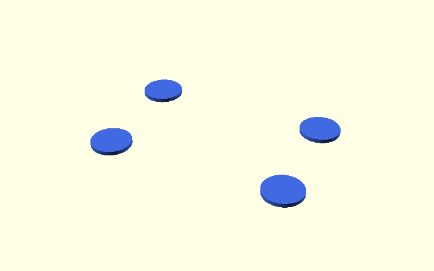
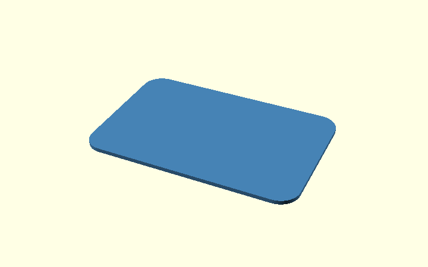
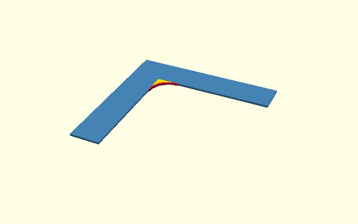
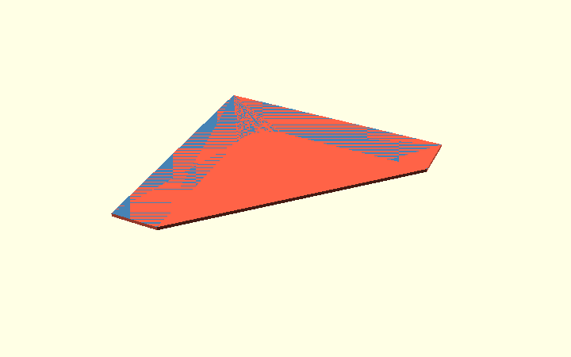

# How OpenSCAD hull() works

This separate, illustrated tutorial explains the `hull()` operation without interrupting the [corner bracket design walkthrough](../index.html).

**The key idea:** `hull()` creates the smallest convex shape around its inputs. That can produce rounded *outside* corners if the inputs are circles, or sloped sides when connecting two rectangles of different sizes. It **cannot preserve the concave inside corner** of an L shape.

You can explore the examples in OpenSCAD using [rounding_explained.scad](../design/rounding_explained.scad) and [hull_explained.scad](../design/hull_explained.scad).

## Rounded corners: circles versus a concave L

`hull()` can produce rounded corners, but only **when the input shapes
already have rounded outside edges**. To see the difference, compare
the circle example with the actual inside corner of the bracket.

**Example A — rounded outside corners using circles**

First place four separate circles at the corners of an imaginary
rectangle. Each circle has a radius of 5 mm.

    module four_circles() {
        for (x = [-22, 22], y = [-13, 13])
            translate([x, y]) circle(r = 5);
    }

Next apply `hull()`. Picture a tight rubber band around all four
circles. It connects the outside of the circles with straight lines,
but **keeps the curved parts at the corners**. So `hull()` does not
calculate a corner radius: `circle(r = 5)` supplies that radius.

    module hull_of_circles() {
        hull() four_circles();
    }

**Example B — why a point-based inside arc was originally used**

Now look at the L-shaped profile before rounding. Its inside corner
is the point `(0, 0)`. Unlike the rectangle above, this is a
**concave corner**: material is missing between the two arms.

    module sharp_L() {
        polygon([
            [0, 0], [armH, 0], [armH, wall],
            [-wall, wall], [-wall, -armV], [0, -armV]
        ]);
    }

One way to round *only that corner* is to calculate points along a
quarter-circle. This was used in the **original v0.1 profile**.
Start with a circle of radius `r`, centred at `(r, -r)`.
The actual bracket still defaults to `r_in = 2` mm, but the teaching
illustration uses `r = 10` mm to make the construction easier to see.

The full circle in this **legacy point-based example** is a visual
construction guide. That earlier method used sine and cosine to
calculate each arc vertex, rather than subtracting a `circle()`:

    x = r + r * cos(a);
    z = -r + r * sin(a);

For example, when `r = 2` mm:

- at 180 degrees, the point is `(0, -2)`: the start of the arc;
- at 135 degrees, it is about `(0.586, -0.586)`;
- at 90 degrees, it is `(2, 0)`: the end of the arc.

The older `for` expression repeats the calculation every 5 degrees
from 180 to 90, producing **19 points**. In this picture, red dots
mark those points. The yellow region shows the material added at
the inside corner. In the current model, the same shape is built
with ordinary 2D `square()` and `circle()` operations.

    corner_arc = (r_in > 0)
        ? [for (a = [180 : -5 : 90])
            [r_in + r_in * cos(a), -r_in + r_in * sin(a)]]
        : [[0, 0]];

In the former implementation, `polygon()` joined the points into a
**single 2D outline**. This picture is retained to explain that
technique, not to show the current `profile()` implementation.

Finally, why not apply `hull()` to the whole L? **Because hull
always makes a convex shape.** It would bridge the space between
the arms and fill most of the L's open inside corner. The red
region below is the unwanted extra material.

    // This is deliberately NOT used for the bracket:
    hull() rounded_L();

**In short:** `hull()` is suitable for rounded *outside* corners made
from circles, but not for this concave L corner. The current bracket
uses **2D `square() - circle()` plus `union()`**. The older approach
using calculated polygon points is kept in the editable
[rounding_explained.scad](../design/rounding_explained.scad) tutorial
as a comparison.

---

## Sloped edges: hull between two rectangular layers

**First, a simpler example.** The bracket is L-shaped, which makes the
chamfer operation harder to see. Let's try the same idea on an ordinary
rectangular bar. The following pictures are generated from the small,
editable [hull_explained.scad](../design/hull_explained.scad) example.

#### A. Start with a plain bar

This rectangular block has straight, sharp edges. It is what we want
to change. In OpenSCAD, `cube()` makes a rectangular solid.

    module original_bar() {
        translate([0, 0, height / 2])
            cube([length, width, height], center = true);
    }

#### B. Make a thin, wide layer at the bottom

Imagine taking a very thin horizontal slice through the bottom of the
bar. It is **as wide and as long as the original bar**, but only 0.5 mm
thick. This is the first shape that we will give to `hull()`.

    module wide_layer() {
        translate([0, 0, slice_thickness / 2])
            cube([length, width, slice_thickness], center = true);
    }

#### C. Put a smaller layer above it

Now add a second thin layer at the **top** of the bar (orange). It is
smaller than the bottom layer (blue): on every side it is 5 mm in from
the edge. **The two layers do not touch yet.** They are the two inputs
for the next operation.

    module narrow_layer() {
        translate([0, 0, height - slice_thickness / 2])
            cube([length - 2 * chamfer, width - 2 * chamfer,
                  slice_thickness], center = true);
    }

#### D. Connect both layers using hull()

Now OpenSCAD wraps the two layers in the **smallest solid that encloses
both of them**. Think of stretching tight plastic film around both.
This is what `hull()` does. Since the bottom is wide and the top is
narrower, the new connecting sides become **sloped**.

    module sloped_hull() {
        hull() {
            wide_layer();
            narrow_layer();
        }
    }

#### E. Compare the before and after

**Left:** the original bar with sharp edges.
**Right:** the result after `hull()`, with sloping edges.
`intersection()` can keep only the volume shared by the original bar
and this new shape. In this simple example the hull is already
completely inside the bar, so `intersection()` changes nothing further.

    module clipped_bar() {
        intersection() {
            original_bar();
            sloped_hull();
        }
    }

**Back to the corner bracket.** The real model uses the same principle,
but the two layers have a different outline: `outer_shape()` instead
of rectangles. The code below uses `offset(delta = -cs)` to make
one outline smaller, `hull()` to connect the two sizes, and
`intersection()` to trim the actual L-shaped bracket. This avoids
having to cut every side edge individually. In contrast to the simple
bar, the bracket's construction keeps the plywood contact faces flat.

## Is hull() the simplest way to round an L corner?

Not for a **concave** (inside) corner. Two ordinary shape-based
methods are easier to understand:

- **2D first:** `difference()` of a `square()` and a `circle()`,
  `union()` that small corner piece with the L, then `linear_extrude()`.
- **3D first:** `difference()` of a `cube()` and a `cylinder()`,
  then `union()` it with the extruded L.

The complete example—including **nine illustrated steps**, both complete
OpenSCAD constructions, and a comparison with point-based `polygon()`—
is on the separate [Polygon and rounded-corner guide](polygon-guide.html).
Those alternatives show the same target shape without using `hull()`.

## Applying this to the actual bracket

The bracket's **inside radius** is now made in **2D** from a small
`square()` with a matching `circle()` subtracted, joined to a sharp L
profile with `union()`, then extruded. The former 19-point
`polygon()` arc is documented above as a historical comparison.
Using 72 circle segments retains the same 5-degree approximation.

For the **outer side-edge chamfers**, the code creates a broad and a slightly inset version of a temporary outline. `hull()` connects these into a sloped limiting shape. `intersection()` keeps only the material shared by the real L profile and that temporary shape.

See [Step 1 and Step 2 of the model design](../index.html) for the actual `profile()`, `side_chamfer_env()`, and `body()` code. The examples are for learning. Step 1 of the real design now uses the
2D boolean approach; the `hull()` demonstration still applies to its
outer side-edge chamfers.

---

## Experiment: both bevels in one hull()

The real bracket currently creates **side-edge chamfers** with a hull-based
limiting volume and **elephant-foot relief** with separate cuts. Can those be
combined? For a **convex straight arm**, yes. The editable
[combined chamfer experiment](../design/combined_chamfer_hull.scad) uses a
single `hull()` around four horizontal rectangular layers:

1. Bottom, inset by `ef = 0.6 mm`.
2. At `z = ef`, full cross-section.
3. Near the top, still full cross-section.
4. Top, inset by `cs = 2 mm`.

The left example below is made with **one hull**; the right example uses
three separate hull segments as a geometrical reference. The XOR
(symmetric difference) is empty for four tested parameter combinations.

**What this does not establish:** the full L bracket has a *concave inner
corner*, a 2 mm inside radius, chamfered arm ends and features that must stay
flat for plywood contact. Hull across the complete L would fill the opening.
A full replacement for `side_chamfer_env()` plus `ef_cuts()` would need
convex subregions and verified joins, including relief around the curved
inside corner. **The production model is intentionally unchanged.**

Run the experiment's independent checks in the Linux toolchain with
`bash scripts/ci/verify-combined-chamfer-experiment.sh` from the model directory
(the CI workflow does this automatically).
