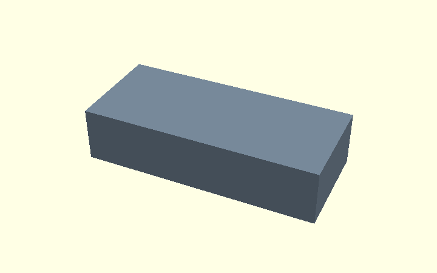
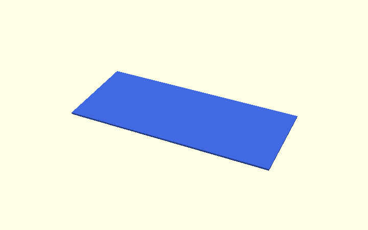
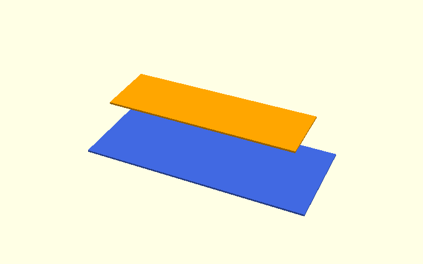
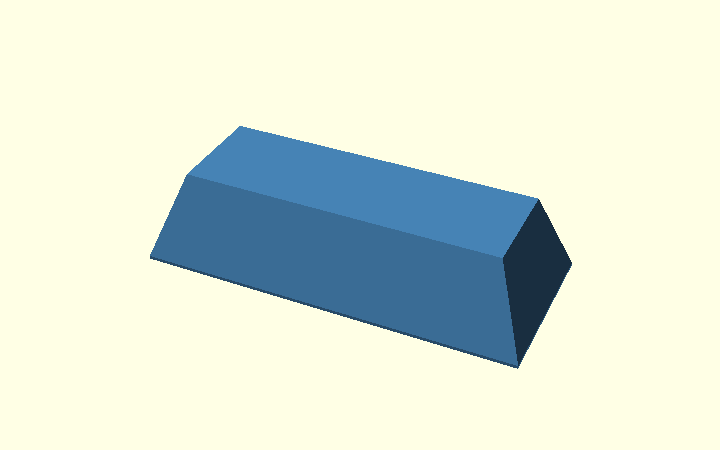
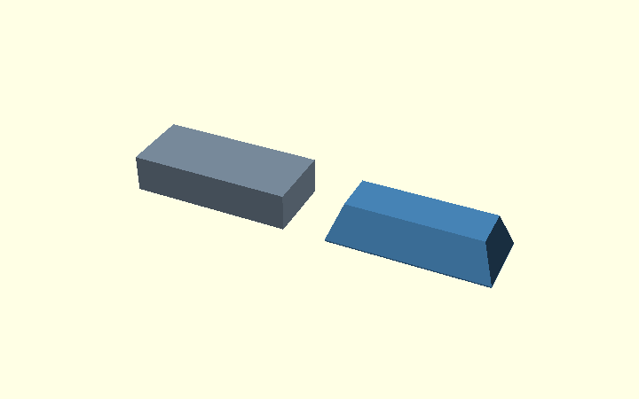
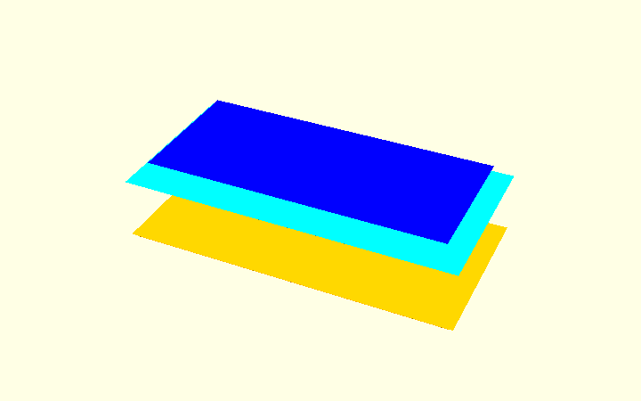
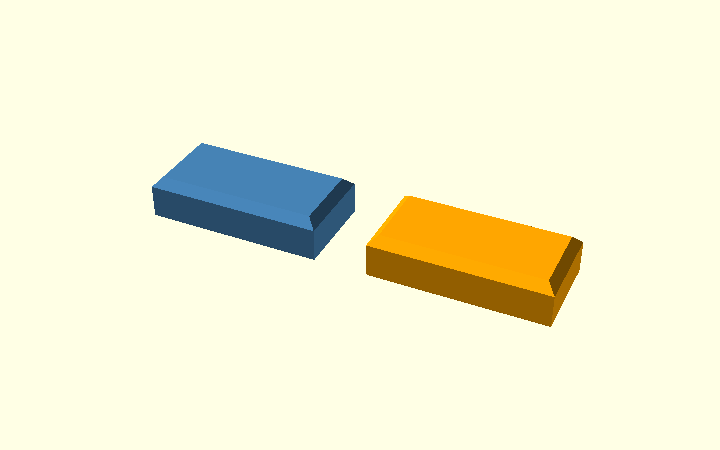

# How hull() creates the bracket's side chamfers

The corner bracket uses `hull()` in **Step 2**, immediately after the
rounded L profile has been extruded. This guide starts with a rectangular
bar, then explains the *actual* bracket construction line by line.

**Go straight to:** [simple bar](#1-first-learn-hull-with-a-rectangular-bar) ·
[actual bracket](#2-how-the-real-corner-bracket-uses-hull) ·
[combined chamfer experiment](#3-experiment-can-hull-also-handle-elephant-foot-relief).

`hull()` wraps its inputs in the **smallest convex shape** containing
them. Think of a tight rubber band in 2D or taut plastic film in 3D.
It can connect differently sized cross-sections with sloping faces.
It does **not** follow a concave L-shaped outline on its own:
an additional `intersection()` is needed.

The editable demonstration is
[hull_explained.scad](../design/hull_explained.scad).
For drawing or rounding the *inside* corner, see the separate
[Polygon and inside-corner guide](polygon-guide.html), including the
former point-based arc method. That is a different operation.

## 1. First learn hull with a rectangular bar

### A. Start with a plain bar

A rectangular solid has straight, sharp edges.



```openscad
module original_bar() {
    translate([0, 0, height / 2])
        cube([length, width, height], center = true);
}
```

### B. Make a wide, thin layer

This horizontal layer covers the whole footprint of the bar.



```openscad
module wide_layer() {
    translate([0, 0, slice_thickness / 2])
        cube([length, width, slice_thickness], center = true);
}
```

### C. Make a smaller layer above it

Move the second layer to the top and inset its four edges by
`chamfer` millimetres. The two layers do not touch.



```openscad
module narrow_layer() {
    translate([0, 0, height - slice_thickness / 2])
        cube([length - 2 * chamfer, width - 2 * chamfer,
              slice_thickness], center = true);
}
```

### D. Connect them with hull

`hull()` creates the connecting sloped faces. It does not need an
explicit polygon for each side.



```openscad
module sloped_hull() {
    hull() {
        wide_layer();
        narrow_layer();
    }
}
```

### E. Compare the result

`intersection()` keeps only the part common to both shapes. Here
the hull already fits inside the original bar, so the intersection
does not visibly change it.



```openscad
module clipped_bar() {
    intersection() {
        original_bar();
        sloped_hull();
    }
}
```

**The principle to carry over:** provide a wide shape and a narrower
shape at different positions; hull connects them. For the bracket,
the shapes are **extruded polygons rather than horizontal rectangles**.

## 2. How the real corner bracket uses hull

This section follows
[`corner_bracket.scad`](../scad/corner_bracket.scad), with the
default settings `W = 20` mm and `cs = 2` mm.

### Step 2.1 — Start with the actual L profile

Step 1 of the [model walkthrough](../index.html) builds a 2D
`profile()` from the L polygon plus the rounded inside corner.
`linear_extrude(height = W, center = true)` gives that shape a
width of 20 mm. `rotate([90,0,0])` makes the extrusion run along
the **Y axis**, so its side faces lie at `Y = -10` and `Y = +10`.


The intended side-edge bevel is 2 mm deep into each outside side
face. We want to keep the *middle* of the part unchanged.

### Step 2.2 — Build a temporary outer envelope

The source defines `outer_shape()` as a **convex polygon** containing
the L. It deliberately bridges the open inside region of the L.
This is not the printable part; it is only a convenient shape for
controlling the outside edges.

```openscad
module outer_shape() {
    polygon([
        [armH, -armV], [armH, t - c], [armH - c, t],
        [-t + ce, t], [-t, t - ce], [-t, -armV + c],
        [-t + c, -armV]
    ]);
}
```

Why use this simpler polygon? A hull of the real L would also
bridge its inside opening. The temporary convex envelope lets us
apply a consistent outside-edge bevel first, and restore the real
inside boundary afterward.

### Step 2.3 — Define two differently sized 3D envelopes

The first envelope has the **full 2D outside outline**, but its
extrusion is only `W - 2*cs = 16` mm wide. It occupies
`Y = -8 ... +8`. It preserves the full outside dimensions in
the middle of the bracket.

The second envelope reaches the **full 20 mm width**, from
`Y = -10 ... +10`, but its 2D outline is inset by `cs = 2` mm
using `offset(delta = -cs)`. At the outermost side faces, its
perimeter is therefore smaller.

```openscad
// Full perimeter, narrower Y span (-8 .. +8 mm).
linear_extrude(height = W - 2 * cs, center = true)
    outer_shape();

// Inset perimeter, full Y span (-10 .. +10 mm).
linear_extrude(height = W, center = true)
    offset(delta = -cs)
        outer_shape();
```

Notice that **width** here refers to the Y direction, while
`offset()` changes the perimeter in the X/Z profile plane. The
combination gives a 2 mm bevel at each outside side face.
The two extrusions overlap: `hull()` connects their outer
boundaries rather than joining two isolated flat plates.

### Step 2.4 — Hull the envelopes, then orient them

```openscad
module side_chamfer_env() {
    rotate([90, 0, 0]) hull() {
        linear_extrude(height = W - 2 * cs, center = true)
            outer_shape();
        linear_extrude(height = W, center = true)
            offset(delta = -cs)
                outer_shape();
    }
}
```

The code constructs the two extrusions in local coordinates,
applies `hull()` to connect their outside surfaces and rotates
the result to match the bracket. This is the direct counterpart
of the simple rectangular-bar example.

### Step 2.5 — Intersect with the true L profile

The limiting envelope is convex, so it also occupies the space
*between* the two arms. We must **not** print that filled-in region.

```openscad
module body() {
    intersection() {
        rotate([90, 0, 0])
            linear_extrude(height = W, center = true)
                profile();
        if (cs > 0)
            side_chamfer_env();
        else
            rotate([90, 0, 0])
                linear_extrude(height = W, center = true)
                    outer_shape();
    }
}
```

The first operand is the true L, including its rounded concave
inside corner. The second is the sloped outside envelope.
`intersection()` keeps only the volume that belongs to **both**.
The result has bevels on the outer side edges, while the L opening
and plywood-facing surfaces remain governed by the original profile.


### Step 2.6 — Keep the other bevels distinct

Three settings can be easy to confuse:

| Parameter | Where it works | How it is currently implemented |
| --- | --- | --- |
| `c` and `ce` | Arm tips and large outside corner, in the side profile | Vertices in the initial 2D `polygon()` |
| `cs` | Outer edges on the two broad Y side faces | `hull()` envelope and `intersection()` |
| `ef` | Edges where printed sides meet plywood-facing surfaces, including the curved inside corner | Separate cutters in `ef_cuts()` |

This explains **why the existing code still has a separate
elephant-foot step**: the `cs` envelope is built around the
*outside convex perimeter*, while the `ef` relief also follows
the **concave inner corner** and its transitions.

## 3. Experiment: can hull also handle elephant-foot relief?

For a **straight, convex arm**, yes: the editable
[combined-chamfer experiment](../design/combined_chamfer_hull.scad)
places four rectangular layers inside a **single hull**:

1. Bottom layer inset by `ef = 0.6` mm.
2. Full-width layer at height `ef`.
3. Full-width layer before the top bevel.
4. Top layer inset by `cs = 2` mm.



The left object uses one hull; the right uses three individual
hull segments as a geometric reference.



A CI script checks symmetric differences for four configurations.
This verifies the **simple rectangular experiment only**, not an
equivalent replacement for the full bracket.

The real bracket's geometry varies around its **concave inside
corner** and rounded wood-contact edge. Replacing both
`side_chamfer_env()` and `ef_cuts()` would require suitable
convex subregions (or another limiting construction) and further
whole-bracket regression tests. **The printable bracket has not
been changed by this experiment.**

## Where to read next

For the rounded inside corner, the previous `sin()/cos()`
point-list method and the current `square() - circle()` method,
see [Polygons and rounded inside corners](polygon-guide.html).
That subject is intentionally separate from this guide about
`hull()` and outside edge chamfers.
