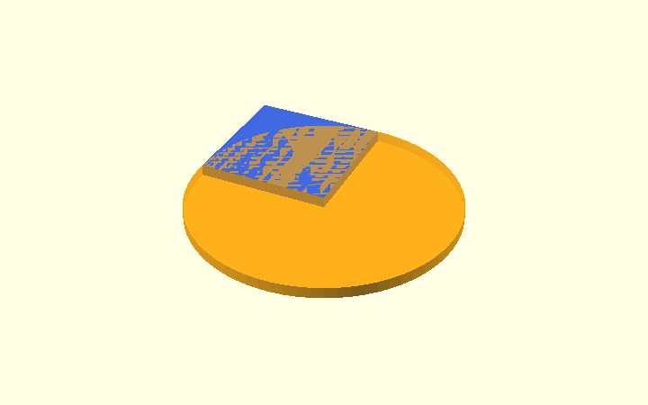
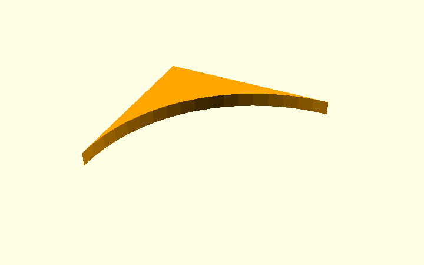
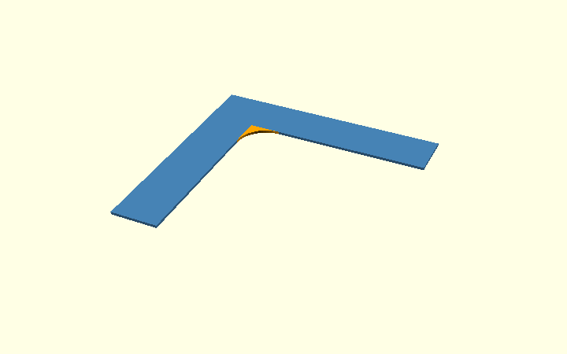
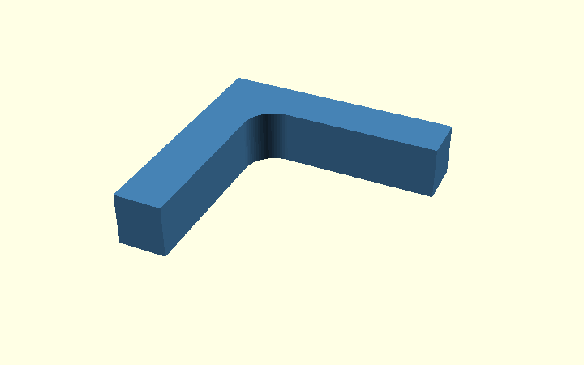
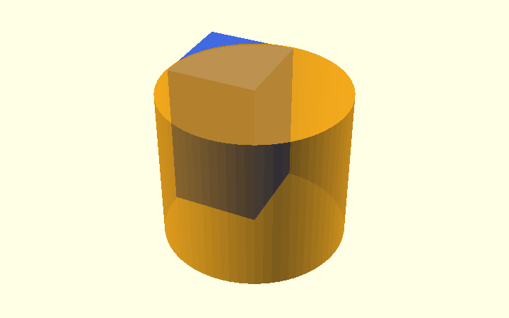
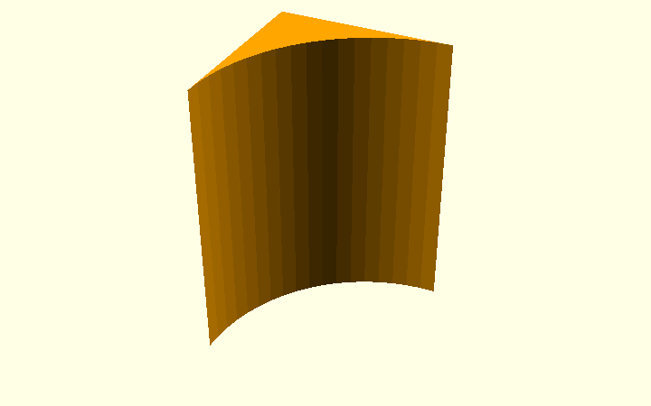

# OpenSCAD polygons and rounded inside corners

A small L bracket is a useful way to learn the difference between **drawing a
shape in 2D** and **building a solid in 3D**. This article uses ordinary
OpenSCAD primitives—`polygon()`, `square()`, `circle()`, `cube()`, and
`cylinder()`—to make the **same rounded concave corner** in two ways.

**Preferred approach for this bracket: start in 2D, then extrude.** It is
easier to see the intended side profile and keeps the boolean construction
separate from thickness, nut pockets, and other 3D details. The 3D method
is included to show how exactly the same idea works with solids.

The illustrations come from the standalone, editable
[inside_corner_methods.scad](../design/inside_corner_methods.scad). Select
`demo_stage` in the OpenSCAD Customizer to view each construction step.

> These are **teaching alternatives**, not a silent replacement of the
> printable v0.1 corner bracket. That model currently constructs its
> `corner_arc` from calculated `polygon()` points. Its outside chamfers,
> nut pockets, and elephant-foot relief are separate operations.

## First: draw a simple L with polygon()

`polygon()` needs a list of coordinates. OpenSCAD joins them in order
and closes the outline. The inside corner is sharp at `(0, 0)`.


```openscad
module sharp_L_2d() {
    polygon([
        [0, 0], [armH, 0], [armH, wall],
        [-wall, wall], [-wall, -armV], [0, -armV]
    ]);
}
```

Here, the demo uses `wall = 18`, `armH = armV = 70` and `radius = 12`
millimetres, so the curved area is visible. The actual bracket defaults
to an **inside radius of 2 mm**.

## Method A (recommended): ordinary 2D shapes, then extrude

### A1. Place a square and a circle

The corner needs a little extra material in the empty quadrant next to
`(0, 0)`. Place a `radius × radius` square at `(0, -radius)`.
Place a circle with the **same radius** at `(radius, -radius)`.



```openscad
module corner_square_2d() {
    translate([0, -radius])
        square([radius, radius]);
}

module corner_circle_2d() {
    translate([radius, -radius])
        circle(r = radius);
}
```

Notice the difference between **a quarter-circle** and **the material
we actually need**: the quarter-circle itself covers the wrong side of
the curve. What we want to add is the *small area in the square that
lies outside the circle*.

### A2. Subtract the circle from the square

`difference()` keeps the square and removes anything the circle overlaps.
The result is a small curved triangular-looking piece.



```openscad
module corner_piece_2d() {
    difference() {
        corner_square_2d();
        corner_circle_2d();
    }
}
```

### A3. Add that piece to the L

`union()` combines the two filled 2D shapes. Only the inside corner
changes; the rest of the original L outline stays where it is.



```openscad
module rounded_L_2d() {
    union() {
        sharp_L_2d();
        corner_piece_2d();
    }
}
```

### A4. Give the 2D shape thickness

Once the 2D profile is correct, a **single** `linear_extrude()` turns
the complete outline into a 3D bracket-like solid.



```openscad
module extruded_from_2d() {
    linear_extrude(height = depth)
        rounded_L_2d();
}
```

This is the approach I would choose when the goal is a **clear,
maintainable model**: finish the side view first, then add depth.

## Method B: build the same corner from 3D solids

The same construction works one dimension higher:

| 2D operation | Corresponding 3D operation |
| --- | --- |
| `square([r, r])` | `cube([r, r, depth])` |
| `circle(r = r)` | `cylinder(r = r, h = depth)` |
| `difference()` in the plane | `difference()` between solids |
| `union()` of 2D areas | `union()` of solids |
| `linear_extrude()` once at the end | Already working in 3D |

### B1. Position a cube and a cylinder

The cube is placed where the 2D square was, and the cylinder is
positioned at the circle's centre. Both cover the **full intended
depth** of the bracket.



```openscad
module corner_cube_3d() {
    translate([0, -radius, 0])
        cube([radius, radius, depth]);
}

module corner_cylinder_3d() {
    translate([radius, -radius, -epsilon])
        cylinder(r = radius, h = depth + 2 * epsilon);
}
```

The small `epsilon` extends the cutter beyond the cube at either end.
It prevents coincident top and bottom faces during the boolean operation;
it **does not** make the finished part thicker.

### B2. Subtract the cylinder



```openscad
module corner_piece_3d() {
    difference() {
        corner_cube_3d();
        corner_cylinder_3d();
    }
}
```

### B3. Add the result to an extruded L


```openscad
module rounded_L_3d() {
    union() {
        linear_extrude(height = depth)
            sharp_L_2d();
        corner_piece_3d();
    }
}
```

Both methods are intended to produce the **same solid**, with the same
radius, depth and circle segmentation. Method A is shorter to reason
about because the round corner is settled **before** anything becomes 3D.

## What does polygon() have to do with the original bracket?

The v0.1 bracket does not use either separate corner piece above. It
calculates **19 points** along a quarter-circle and puts those points
directly into its one `polygon()` outline.


```openscad
corner_arc = (r_in > 0)
    ? [for (a = [180 : -5 : 90])
        [r_in + r_in * cos(a),
         -r_in + r_in * sin(a)]]
    : [[0, 0]];

// The actual profile() joins the arm points and corner_arc
// in one polygon(concat(...)).
```

This approach is **not wrong**. It is especially useful when a profile
must be expressed as a single ordered list of vertices, or when control
over the individual segments matters. But for learning and for this
local rounded corner, **`square() - circle() + union()` is easier
to understand and modify**.

The shape comparison depends on segment resolution. Here `$fn = 72`
gives circle segments every 5°, matching the existing angular step.
That makes results closely comparable but is **not proof that all the
other bracket details remain identical**.

## A third compact option: two offsets

A 2D `offset()` pair can round concave corners too:

```openscad
offset(r = -radius)
    offset(r = radius)
        sharp_L_2d();
```

It is short, but operates on the **whole outline**. It can therefore
affect other narrow details or chamfered ends. The square-minus-circle
method changes **only the chosen corner**, which is why it is the
clearer demonstration for the existing corner bracket.

## 2D first or 3D first?

Use **2D first** when the cross-section can be drawn with rectangles,
circles and polygons, and remains the same along the thickness.
Use **3D first** when depth changes locally or a hole, recess or other
feature needs a genuine volume subtraction. For this model, it is
reasonable to combine them: make the L and the inside radius in 2D,
extrude, then subtract the 3D nut pockets and print-relief cutters.

The existing printable corner bracket stays unchanged while these
alternatives are being studied. Before replacing its `corner_arc`,
compare the generated solid, exact boundary positions, mating fit,
STL output and print-compensation details.
