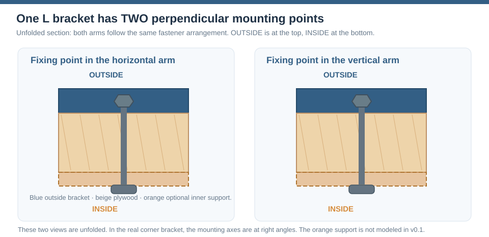
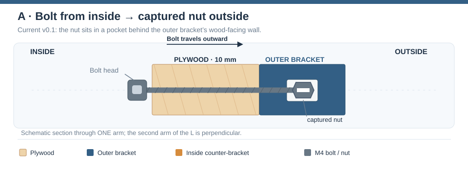
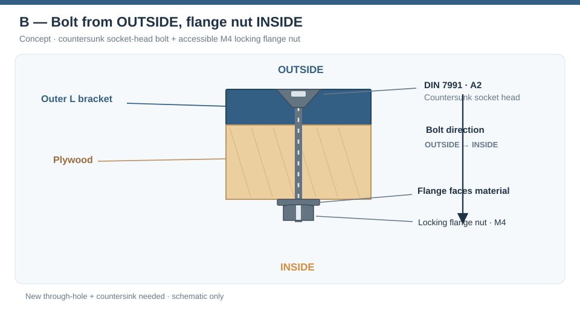
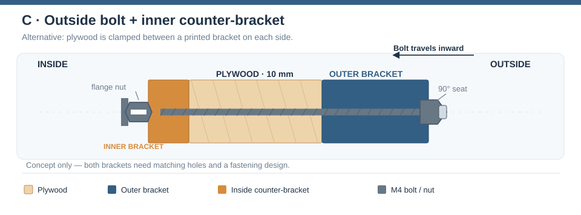
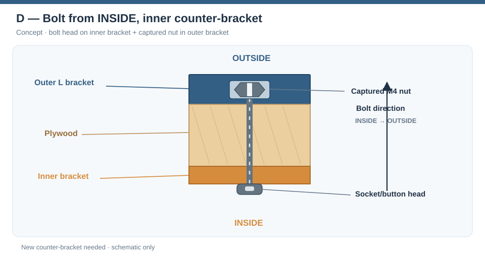
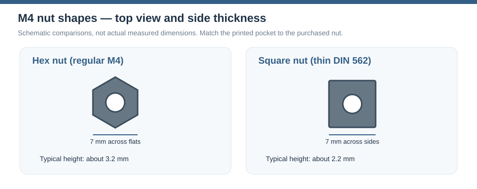

# Corner bracket — mounting options

The bracket joins two **10 mm plywood panels** from the outside. The main
choice is **which side the M4 bolt enters from** and **where the nut sits**.
A second, optional bracket on the inside could clamp the plywood between
two parts.

These are **design alternatives**, not all features of the current printable
model. The [v0.1 OpenSCAD model](scad/corner_bracket.scad) currently implements
an **inside-to-outside bolt** and a **captured nut inside the outer bracket**.
Do not assume that another arrangement is already printable.

The **cross-section drawings** below illustrate one arm of the outside
L bracket. The second arm is perpendicular and uses the same bolt arrangement.
They are **concept sketches, not dimensioned manufacturing drawings**:
the bracket thicknesses, head geometry and clearances are schematic.
Blue is the outside bracket, orange is an optional inside counter-bracket,
beige is plywood and grey is M4 hardware.



The overview shows the **actual right-angle arrangement**: there is a
fixing point on each arm of the outer L bracket. The optional inside
counter-bracket is drawn in orange with a dashed outline because it is
a **future concept**, not part of the existing CAD.

## Which side receives the bolt?

The diagrams below show the stack through **one arm** of the L bracket.
The same principle applies to the other arm, which is at right angles.

**A — Bolt from inside, captured nut in the outer bracket (current design)**



The bolt passes through the plywood from the inside and screws into a nut
held inside the outer bracket. The nut is inserted through the bracket's
wood-facing access window; a separate printed plug covers the window.
Because the nut cannot rotate, installation only requires access to the
**bolt head on the inside**.

This is convenient when the outside should have **no visible screw head**.
It is also the least disruptive option because the v0.1 CAD already includes
the nut pocket, access window, bolt hole and plug.

**B — Bolt from outside, loose or locking nut on the inside (alternative)**



The bolt head would be visible on the outer bracket, or sit flush in a
**90° countersink**. A nut on the inside can be held with a wrench while the
bolt is tightened. An optional **flanged locking nut** spreads contact over
more area than an ordinary hex nut and helps resist loosening.

This needs a **new CAD variant**: the current outer bracket has a closed
outside skin and a blind bolt-tip hole, not a clearance hole and countersink
for a bolt entering from the outside. Also verify that a countersink leaves
enough printed material around the head.

**C — Two brackets: outside corner bracket plus inside counter-bracket**



A second L bracket on the **inside** can spread the clamping force over a
larger section of plywood and help locate both panels during assembly.
It could use either loose hex/flange nuts or captured hex/square nuts. The
two bracket parts and their bolt holes must line up.

The inner bracket adds **print time, space and an extra part**. It is not
automatically stronger: the load also depends on plywood strength, bracket
geometry, screw positioning, print orientation and tightening force.
In particular, a printed counter-bracket needs enough clearance at the
inside plywood corner. This is a **future CAD design**, not part of v0.1.

The direction can also be reversed, with bolt heads bearing on the inner
counter-bracket and captured nuts in the outer bracket. That would keep
the outside closed while offering a larger inside bearing surface.

**D — Inside bolt with an inside counter-bracket and outer captive nut**



This option retains a closed exterior but requires additional room for
the inside bracket and a matching bolt hole. It has **not been modeled**.

## Comparison

| Arrangement | Where is the nut? | What is visible outside? | CAD status |
| --- | --- | --- | --- |
| Inside → outside | Captured **hex nut** in outer bracket | Smooth bracket | **Implemented** (v0.1 default) |
| Inside → outside | Captured **square nut** in outer bracket | Smooth bracket | **Selector present**, test fit required |
| Outside → inside | Loose hex nut or **locking flange nut** inside | Screw head, possibly countersunk | **New geometry required** |
| Outside → inside, two brackets | Nut in / behind inner counter-bracket | Screw head, possibly countersunk | **New inner + outer designs required** |
| Inside → outside, two brackets | Captured nut in outer bracket | Smooth bracket | **New inner counter-bracket required** |

## Hexagonal or square M4 nuts?

Both shapes can stop the nut rotating when enclosed in a matching printed
pocket. What differs is how the nut is held, how much space it occupies,
and how much threaded height is available.

| Feature | Regular M4 hex nut | Thin M4 square nut (DIN 562) |
| --- | --- | --- |
| Shape | Six sides | Four sides |
| Nominal width across flats/sides | About **7 mm** | **7 mm** |
| Typical nominal thickness | About **3.2 mm** | **2.2 mm** |
| Pocket shape | Hexagonal | Square |
| Rotation prevention | Needs correctly oriented hexagonal pocket | Flat faces make a rectangular capture slot straightforward |
| Main trade-off | More thread engagement height | Lower-profile pocket, **less thread engagement** |



The drawing shows the **head-on shape** and typical thickness difference.
A square nut can sit in a simpler straight-sided slot, but the thinner
DIN 562 nut has less thread engagement than a regular-height M4 hex nut.
Verify the actual nut and pocket dimensions before printing.

The thin square-nut dimensions are from the DIN 562 reference below; actual
products must be measured. A square nut is not necessarily interchangeable
with a normal-height hex nut merely because both are M4.

The current model already has `nut_type = "hex"` or `"square"` in its
Customizer. However `nut_h = 3.2` is **not changed automatically** when
switching types. A DIN 562 M4 square nut is typically **2.2 mm** thick, so
review `nut_h`, `nut_flats`, `nut_clr`, window clearance and plug fit before
printing. The current slot geometry has **not been validated** with the
linked PRORAJE nuts.

**A flanged locking nut is a separate option.** Its flange and locking
feature need more space than a normal captive M4 hex nut. Do not put it
into the existing captive pocket without redesigning and measuring it.
It makes most sense as an **accessible nut on the inside**.

## Bolt heads: countersunk or projecting?

A **countersunk socket-head bolt** (DIN 7991, related to ISO 10642) is useful
when a flush surface matters. It requires a matching **90° countersink**.
For an M4 DIN 7991 head, a useful nominal reference is **8 mm head diameter**
and **2.3 mm head height**, with a **2.5 mm Allen key**; check the exact
purchased fastener.

A projecting socket or button head avoids machining a deep countersink,
but remains visible. Against plywood, consider a suitable washer or
spreading plate and avoid crushing the wood.

### Watch the bolt length — M4×10 is not a universal choice

`M4×10` means a nominal **10 mm bolt length**, including the head for
countersunk screws. The existing joint uses **10 mm plywood alone**,
before the threads even reach a nut in the outer bracket.

For the **current inside-to-outside captive-nut design**, approximate
distance from the inside face to the far side of the nut is:

```text
plywood                 10.0 mm
bracket retaining wall   3.0 mm
nominal hex nut          3.2 mm
-------------------------------
total                   16.2 mm
```

That makes **M4×10 too short** for this assembly and **M4×16 borderline**
before considering tolerances, full-thread engagement, the countersink and
the available blind hole. A longer bolt cannot simply be assumed to fit:
the outer surface is deliberately closed.

For an outside-in arrangement, the bolt might have to span the **outer
bracket, 10 mm plywood and nut**. A two-bracket sandwich adds the inner
bracket as well. These alternatives need a **fresh bolt-length calculation**
from the final CAD cross-section and a physical fit test; do not reuse the
10 mm bolt just because it is the convenient catalogue example.

## Product references

The following links are **candidate components**, not a validated bill of
materials. Material and size are taken from their listing titles or the
standards linked below. Check pack size, stock, dimensions and tolerances
at ordering time.

- **Square nuts:** [PRORAJE square stainless nuts, Amazon NL (ASIN
  B0F412QQ32)](https://www.amazon.nl/dp/B0F412QQ32). The listing could
  not be read automatically, so its exact dimensions and available size
  selection still need checking. A third-party project references this
  ASIN for **M4 A2/304, approximately 7 × 7 × 2.2 mm**; that does not
  substitute for measuring the purchased nuts.
- **Preferred countersunk bolt material:** [Dresselhaus M4×10 DIN 7991,
  stainless steel A2, Hornbach](https://www.hornbach.nl/p/dresselhaus-metaalschroef-verzonken-kop-binnenzeskant-4x10-mm-din-7991-rvs-a2-100-stuks/6834946/).
  **Length is a component example only**; it is too short for the
  current 10 mm plywood joint.
- **Alternative, galvanized:** [Dresselhaus M4×10 DIN 7991 zinc-plated,
  Hornbach](https://www.hornbach.nl/p/dresselhaus-binnenzeskantbout-verzonken-kop-4x10-mm-din-7991-galv-verzinkt-100-stuks/7662372/).
  The stainless A2 option is the more interesting starting point.
- **Inside nut candidate:** [Marinetech M4 A2-70 locking flange nut,
  Hornbach](https://www.hornbach.nl/p/marinetech-flensmoer-borg-zeskant-m4-rvs-a2-70-500-stuks/12120010/).
  It is a possible **accessible inside nut**, not a drop-in captive nut.
  The supplied product URL describes a pack of **500**; dimensions and
  current availability require checking.

Useful technical references:
[DIN 562 thin M4 square-nut dimensions (Reyher)](https://www.reyher.de/fileadmin/user_upload/Downloadbereich/Reyher_2019-EN_Technische_Informationen_ks.pdf);
[M4 countersunk screw dimensions (DIN 7991, Fuller Fasteners)](https://fullerfasteners.com/tech/din-7991-specifications-hex-socket-countersunk-head-cap-screws/).

## Suggested prototype tests

1. Print the **existing captive-hex version** first and confirm both
   insertion windows, plug retention, and M4 head/bolt clearance.
2. Print a **square-nut pocket test piece**, using measured PRORAJE
   dimensions and the intended print material, before changing the whole bracket.
3. Model the **outside-in head and countersink** as a separate variant;
   test remaining wall thickness, the 90° seat and access to the inside nut.
4. If the joint needs more clamping area, make a **separate inside
   counter-bracket prototype**, aligning both bolts and avoiding interference
   with the plywood corner.
5. Compare assembly time, repeatability, crushing of plywood, print-layer
   direction and joint movement under real use. Do not infer a load rating
   from CAD alone.

**Status:** concept comparison. Only the inside-to-outside captive-nut
configuration currently has production CAD geometry, and the entire joint
still needs physical validation.
