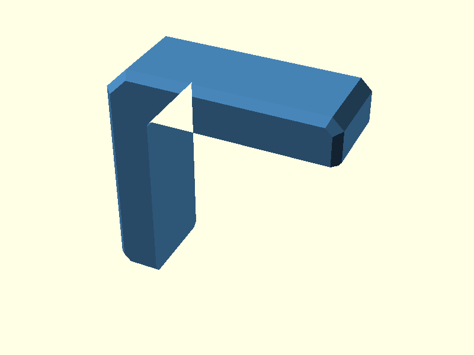
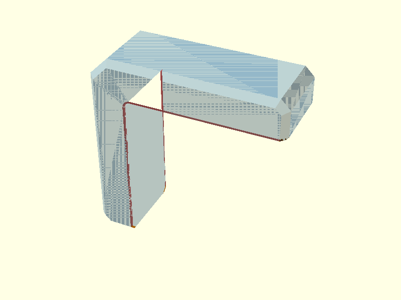
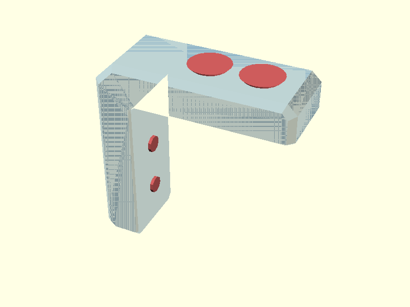
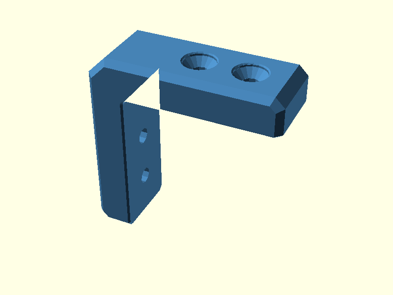

# V0.1
# Corner bracket — v0.1

Simplified outside-corner bracket for two plywood panels.

The current model uses **four M5 DIN 7991-style countersunk bolts**:
two through each arm, entering from the outside and secured with an
accessible washer and nut on the inside.

The former captive-nut pockets, access windows and printed plugs are no
longer part of the production model.

**This is still a prototype.** Verify plywood fit, countersink dimensions,
bolt length, print compensation and mechanical strength with real parts.

## Design walkthrough

### 1. Build the L profile

`base_profile_2d()` contains the arm-end chamfers and large outside corner
chamfer. `inside_corner_fill_2d()` adds the rounded inside corner.

The tiny elephant-foot bevel on the two arm end faces is kept in this 2D
profile instead of adding another pair of 3D cutters.

### 2. Create the outside side chamfer

`outer_side_chamfer_keep_envelope()` connects two convex outside profiles
with `hull()`. `intersection()` then clips that keep envelope with the real
L-shaped `profile_body()`.

The hull creates the slope; the intersection only restores the real L
boundary.

### 3. Remove one continuous side relief per print face

`inside_opening_2d()` describes the complete plywood-facing opening:
horizontal edge, rounded inside corner and vertical edge.

`inside_side_relief_cuts()` creates one continuous hull on each broad
printable side between the normal opening and an enlarged opening.

Only the small junction where this relief reaches the diagonal outside
side chamfer needs a separate local correction.

`arm_tip_relief_cuts()` now uses one simple triangular prism placed with
fixed `translate()`, `rotate()` and `mirror()` calls. The previous
`multmatrix()` construction is no longer needed.

    module print_compensated_body() {
        difference() {
            outer_side_chamfered_body();
            inside_side_relief_cuts();
            arm_tip_relief_cuts();
        }
    }

### 4. Cut four countersunk M5 bolt paths

Two bolt positions are generated on each arm. `bolt_cuts()` applies the
same `countersunk_bolt_cut()` at all four positions.

The default source uses M5 × 30 with a 12 mm printed wall, 10 mm plywood,
washer and nut. The model echoes the minimum stack and the closest
approach between perpendicular bolt tips.

### 5. Final printable bracket

    module bracket() {
        difference() {
            print_compensated_body();
            bolt_cuts();
        }
    }

### 6. Installed preview

The plywood and hardware are display-only ghosts. They are not included
in the bracket STL.

## Further reading

The [Chamfer Guide](docs/chamfer-guide.html) shows the continuous print
relief and the small arm-tip correction in detail.

The [Hull Guide](docs/hull-guide.html) explains why `hull()` is used once
as **keep geometry** for the outside chamfer and once as **cut geometry**
for the continuous inside relief.

The [Polygon Guide](docs/polygon-guide.html) explains the rounded inside
corner.

The [M5 Mounting Guide](docs/mounting-options.html) documents the current
outside-to-inside four-bolt arrangement.

## Printing and assembly

1. Print the bracket on one broad flat side.
2. Check the elephant-foot relief and plywood corner fit before drilling.
3. Use the bracket as a drilling template only after that fit check.
4. Install two M5 bolts per arm from outside to inside.
5. Fit washer and nut on the inside and tighten without crushing the
   plywood or printed countersink.

The generated BOM contains only the printed bracket. Plywood and hardware
are assembly materials, not printed BOM items.

---
## Table of Contents
1. [Parts list](#Parts_list)
1. [Main Assembly](#main_assembly)

[Top](#TOP)

---

## Parts list
| Main | TOTALS |  |
|---:|---:|:---|
|  | | **3D printed parts** |
| &nbsp;&nbsp;1&nbsp; |  &nbsp;&nbsp;1&nbsp; | &nbsp;&nbsp;corner_bracket.stl |
| &nbsp;&nbsp;1&nbsp; | &nbsp;&nbsp;1&nbsp; | &nbsp;&nbsp;Total 3D printed parts count |

[Top](#TOP)

---

## Main Assembly
### 3D Printed parts

| 1 x [corner_bracket.stl](stls/corner_bracket.stl) |
|---|
|  

### Assembly instructions

Printable bracket.

[Top](#TOP)
