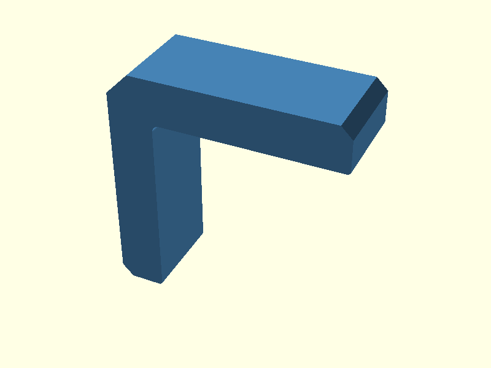
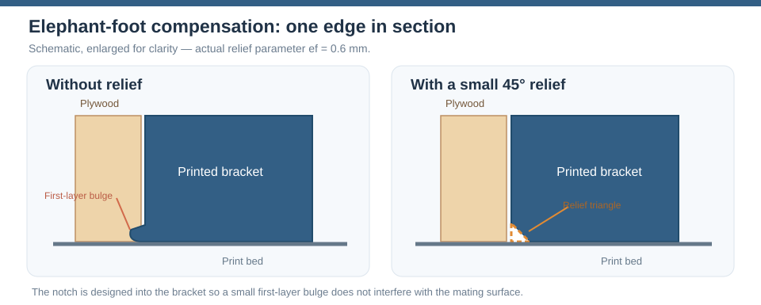
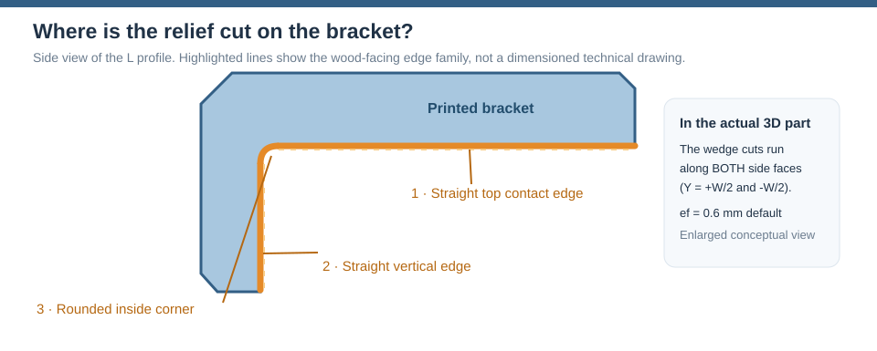
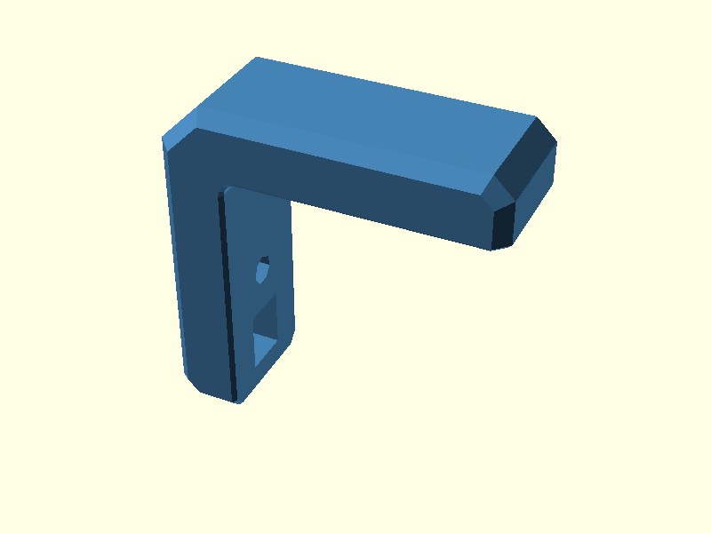
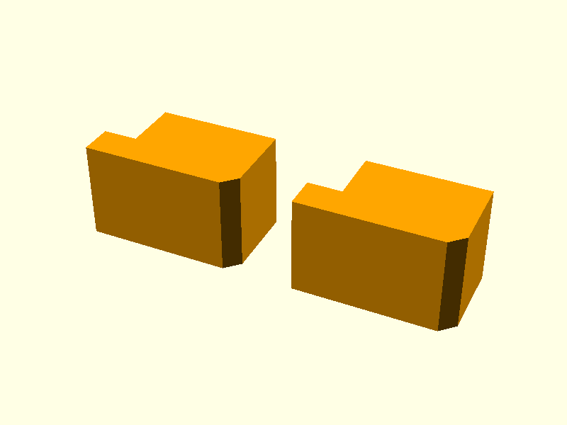
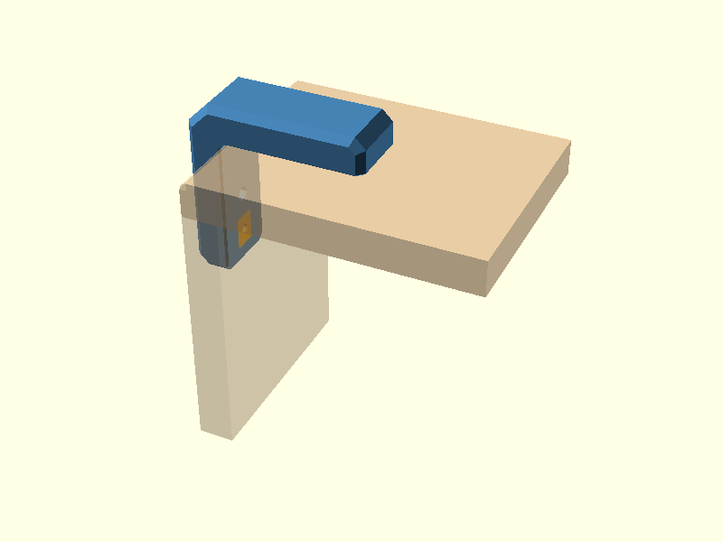
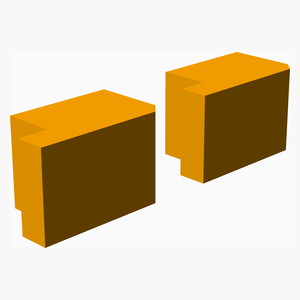
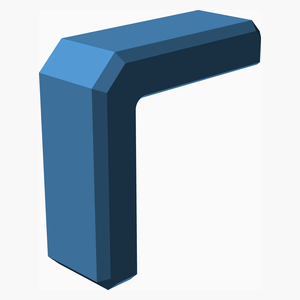
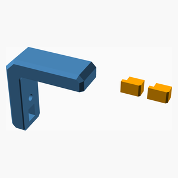

# V0.1
# Corner bracket — v0.1

Outside-corner bracket for two 10 mm plywood panels. The original
parametric design is in [corner_bracket.scad](scad/corner_bracket.scad).
It has two captive-nut pockets accessible from the wood-facing surfaces
and two removable plugs that conceal the access windows after assembly.

**This is a work in progress.** Test-fit the M4 fasteners, nuts, printed
clearances, plywood corner relief and printed-part strength before use.
All dimensions below are millimetres.

## Design walkthrough

The six pictures show how the bracket is built, from a flat drawing to the finished part. Each step first explains **what happens and why**, then shows the corresponding OpenSCAD code. You do not need to understand every line at once. The complete model is in [corner_bracket.scad](scad/corner_bracket.scad); you can explore the steps in [design.scad](scad/design.scad). All dimensions are in millimetres.

### 1. L-shaped polygon profile

**First draw the bracket from the side.** Imagine marking points on graph paper and connecting them with straight lines. In OpenSCAD, `polygon()` connects those points and fills the area. `concat()` joins three groups of points: the top end (`tip_top`), the main outside edges and bottom end (`tip_vert`), and the rounded inside corner (`corner_arc`). The curve is made from several nearby points rather than one perfect arc.

**Then give the flat drawing thickness.** `linear_extrude()` turns the 2D shape into a 3D part, 20 mm wide (`W`). `rotate()` puts that width in the correct direction. The small diagonal cuts at the arm ends and outer corner (`c` and `ce`) are already part of the drawing.

**Relevant OpenSCAD code:**

    corner_arc = (r_in > 0)
    ? [for (a = [180 : -5 : 90]) [r_in + r_in * cos(a), -r_in + r_in * sin(a)]]
    : [[0, 0]];
    tip_top  = (ef > 0) ? [[armH - ef, 0], [armH, ef]] : [[armH, 0]];
    tip_vert = (ef > 0) ? [[-ef, -armV], [0, -armV + ef]] : [[0, -armV]];
    
    module profile() {
        polygon(concat(tip_top, [
            [armH, t - c],            // 45-degree top-arm end
            [armH - c, t],
            [-t + ce, t],
            [-t, t - ce],             // 45-degree outside corner
            [-t, -armV + c],
            [-t + c, -armV]           // 45-degree vertical-arm end
        ], tip_vert, corner_arc));    // rounded inside corner from (0,-r) to (r,0)
    }
    
    module profile_extrusion() {
        rotate([90, 0, 0])
            linear_extrude(height = W, center = true)
                profile();
    }

**Why is there no `hull()` for the inside corner?** `hull()` would
fill the open space between the two arms. Instead, the code calculates
19 points along a quarter-circle with `sin()` and `cos()`, then includes
those points in the L-shaped `polygon()`. See the separate
[illustrated guide to hull and rounded corners](hull-guide.html).

### 2. Outer side-edge chamfers

The sharp *side* edges get a bevel. The code first creates two versions
of the outside outline: one narrower in width and one with a smaller
perimeter. `hull()` connects them with sloping surfaces.
`intersection()` then trims the original L profile to that shape.
The two pieces still meet the plywood on flat faces. The parameter
`cs = 2` controls this bevel; `c` and `ce` belong to the 2D
polygon from Step 1.

For an explanation with a **simple bar, the two separate shapes, and
the result of hull()**, see the [separate illustrated hull guide](hull-guide.html).

**Relevant OpenSCAD code:**

    module outer_shape() {
        polygon([
            [armH, -armV], [armH, t - c], [armH - c, t], [-t + ce, t],
            [-t, t - ce], [-t, -armV + c], [-t + c, -armV]
        ]);
    }
    
    module side_chamfer_env() {
        rotate([90, 0, 0]) hull() {
            linear_extrude(height = W - 2 * cs, center = true) outer_shape();
            linear_extrude(height = W, center = true) offset(delta = -cs) outer_shape();
        }
    }
    
    module body() {
        intersection() {
            rotate([90, 0, 0]) linear_extrude(height = W, center = true) profile();
            if (cs > 0) side_chamfer_env();
            else rotate([90, 0, 0]) linear_extrude(height = W, center = true) outer_shape();
        }
    }

### 3. Captive nuts and access windows

**Now make room for the bolts and nuts.** OpenSCAD can treat ordinary shapes as cutting tools. Put a cylinder or box where you want a hole, then use `difference()` to subtract it from the bracket.

For each arm, the code makes four spaces: a hexagonal pocket for an M4 nut, a short slot to slide the nut into position, an opening on the wood-facing side to insert the nut, and the bolt hole. `cylinder($fn = 6)` is a cylinder with **six flat sides**, so it matches a hex nut; `cube()` cuts rectangular slots and openings. The two arms use the same idea but in different directions (`nut_top()` and `nut_side()`). The bolt's extra clearance is a **blind hole**, so it does not break through the outside wall.

**Relevant OpenSCAD code:**

    Wn       = nut_flats + nut_clr;   // nut pocket width (across flats)
    Ln       = (nut_type == "hex") ? Wn / cos(30) : Wn;   // pocket length (hex vertex-to-vertex)
    pocket_h = nut_h + 0.4;           // nut-pocket depth
    skin     = t - wood_wall - pocket_h - tip_hole;   // closed outside wall
    D        = wood_wall + pocket_h;  // window depth from wood-facing surface
    Lw       = Ln + win_extra;        // window length
    hx = ply_t + bolt_edge;           // top-arm bolt X position
    vz = -(ply_t + bolt_edge);        // vertical-arm bolt Z position
    tip_x = hx + Ln / 2 + lip_len;    // top-arm window start
    tip_z = vz - Ln / 2 - lip_len;    // vertical-arm window start
    
    module nut_top() {
        z0 = wood_wall;
        if (nut_type == "hex") {
            translate([hx, 0, z0]) cylinder(d = Ln, h = pocket_h, $fn = 6);
            translate([hx, -Wn / 2, z0]) cube([Ln / 2 + lip_len + 0.02, Wn, pocket_h]);
        } else
            translate([hx - Ln / 2, -Wn / 2, z0]) cube([Ln + lip_len + 0.02, Wn, pocket_h]);
        // Window opening from the wood-facing surface.
        translate([tip_x - 0.01, -Wn / 2, -0.01]) cube([Lw + 0.01, Wn, D + 0.01]);
        // Bolt hole through retaining wall plus blind clearance behind nut.
        translate([hx, 0, -1]) cylinder(d = bolt_d + bolt_clr, h = wood_wall + 2);
        translate([hx, 0, z0 + pocket_h - 0.01]) cylinder(d = bolt_d + bolt_clr, h = tip_hole + 0.01);
    }
    
    module nut_side() {
        x0 = -D;
        if (nut_type == "hex") {
            translate([x0, 0, vz]) rotate([0, 90, 0]) cylinder(d = Ln, h = pocket_h, $fn = 6);
            translate([x0, -Wn / 2, tip_z - 0.02]) cube([pocket_h, Wn, Ln / 2 + lip_len + 0.02]);
        } else
            translate([x0, -Wn / 2, tip_z - 0.02]) cube([pocket_h, Wn, Ln + lip_len + 0.02]);
        // Window opening from the wood-facing surface.
        translate([x0, -Wn / 2, tip_z - Lw]) cube([D + 0.01, Wn, Lw + 0.01]);
        // Bolt hole through retaining wall plus blind clearance behind nut.
        translate([1, 0, vz]) rotate([0, -90, 0]) cylinder(d = bolt_d + bolt_clr, h = wood_wall + 2);
        translate([x0 + 0.01, 0, vz]) rotate([0, -90, 0]) cylinder(d = bolt_d + bolt_clr, h = tip_hole + 0.01);
    }
    
    difference() {
        body();
        nut_top();
        nut_side();
    }

### 4. Elephant-foot relief

**What is elephant foot?** The very first printed layers sometimes
spread sideways where they touch the print bed. A nominally square edge
can become slightly wider at the base. The bracket is printed on one
of its flat **side faces**, so this bulge can interfere with the surfaces
where the bracket should fit against the plywood.

The solution is not to change the entire bracket. We remove a very
small **45-degree triangle** at the edges near the print bed. The
parameter `ef = 0.6` mm sets the nominal size of this relief;
the illustration deliberately exaggerates it so you can see the cut.

**Where are these triangles removed?** The bracket has three kinds of
wood-facing edges: a straight edge along the horizontal arm, a straight
edge along the vertical arm, and the rounded inside corner. Relief is
applied at **both printed side faces** (`Y = +W/2` and `Y = -W/2`).

The OpenSCAD code constructs the cutting shapes in stages:

1. `ef_wedge_profile()` draws a tiny **triangle in 2D** using
   `polygon()`. It is the cross-section of the material to remove.
2. `linear_extrude()` stretches that triangle along each **straight**
   contact edge, like pulling a triangular knife along the bracket.
   `mirror()` repeats the operation on the other printed side.
3. At the short **diagonal corners**, `ef_edge_wedge()` uses
   `multmatrix()` to position the same triangular cutter at an angle.
4. For the **rounded inside corner**, `rotate_extrude()` sweeps a
   triangular cutter around a circular path rather than along a line.
5. Finally, `difference()` inside `bracket()` subtracts all these
   cutters from the body, along with the nut pockets and bolt holes.

Setting `ef = 0` disables the relief. The diagonal cutters depend on
`cs > 0`, and the rounded cutter is used when `r_in >= 1`. This is
an allowance for printing, **not** a substitute for checking fit on
an actual print.

The following render shows the resulting bracket. The complete
cutter modules used in the source code are listed underneath.

**Relevant OpenSCAD code:**

    module ef_wedge_profile() {   // triangle in local (u=y, v=material depth) coordinates
        polygon([[W / 2 - ef - 1, -1], [W / 2 + 1, -1], [W / 2 + 1, ef + 1]]);
    }
    
    module ef_edge_wedge(A, U, V, D, len) {
        multmatrix([[U[0], V[0], D[0], A[0]],
                    [U[1], V[1], D[1], A[1]],
                    [U[2], V[2], D[2], A[2]],
                    [0, 0, 0, 1]])
            linear_extrude(height = len)
                polygon([[-ef - 1, -1], [1, -1], [1, ef + 1]]);
    }
    
    module ef_cuts() {
        s2 = sqrt(2) / 2;
        if (ef > 0) for (m = [0, 1]) mirror([0, m, 0]) {
            // Diagonal corners where side and end chamfers meet.
            if (cs > 0) {
                // Top arm: (armH-cs, W/2) to (armH, W/2-cs) at z=0.
                ef_edge_wedge([armH - cs - s2, W / 2 + s2, 0], [s2, s2, 0], [0, 0, 1], [s2, -s2, 0],
                              cs * sqrt(2) + 2);
                // Vertical arm: (W/2-cs, -armV) to (W/2, -armV+cs) at x=0.
                ef_edge_wedge([0, W / 2 - cs - s2, -armV - s2], [0, s2, -s2], [-1, 0, 0], [0, s2, s2],
                              cs * sqrt(2) + 2);
            }
            // Edge along the top arm (z=0, x=r_in..armH).
            translate([r_in, 0, 0]) rotate([90, 0, 90])
                linear_extrude(height = armH + 1 - r_in) ef_wedge_profile();
            // Edge along the vertical arm (x=0, z=-r_in..-armV).
            translate([0, 0, -armV - 1]) rotate([0, 0, 90])
                linear_extrude(height = armV + 1 - r_in) ef_wedge_profile();
            // Edge along the rounded inside corner.
            if (r_in >= 1)
                translate([r_in, 0, -r_in]) rotate([90, 0, 0]) rotate([0, 0, 89])
                    rotate_extrude(angle = 92)
                        polygon([[r_in - 1, W / 2 - ef - 1], [r_in - 1, W / 2 + 1], [r_in + ef + 1, W / 2 + 1]]);
        }
    }
    
    module bracket() {
        difference() {
            body();
            nut_top();
            nut_side();
            ef_cuts();
        }
    }

### 5. Access-window plugs

**The nut windows need covers.** Each plug starts as a small side-view drawing made with `polygon()`. The shape includes a hook that slips under the lip inside the bracket. `linear_extrude()` gives the plug its width; `plug_clr` leaves a little space around it so it can fit.

`difference()` can also cut a small hole or screwdriver slot to help remove the plug. `plug_print()` places one plug on its side for printing, and `plugs_print_pair()` puts **two separate plugs** next to each other in the STL.

**Relevant OpenSCAD code:**

    module plug_local() {
        pc = plug_clr;
        pw = Wn - 2 * pc;
        difference() {
            rotate([90, 0, 0]) linear_extrude(height = pw, center = true)
                polygon([
                    [pc, 0], [Lw - pc, 0],
                    [Lw - pc, D - pc - plug_ch], [Lw - pc - plug_ch, D - pc],   // insertion bevel
                    [-lip_l, D - pc],                                           // bottom face and tab
                    [-lip_l, D - pc - lip_thk], [pc, D - pc - lip_thk]
                ]);
            // Extraction hole (pin/small screw) or screwdriver slot.
            if (plug_handle == "hole") translate([Lw / 2, 0, -1]) cylinder(d = 2.5, h = 5, $fn = 24);
            if (plug_handle == "slot") translate([Lw - pc - 3, -pw / 2 - 1, -1]) cube([1.2, pw + 2, 3]);
        }
    }
    
    module plug_print() {
        translate([lip_l, D, (Wn - 2 * plug_clr) / 2]) rotate([90, 0, 0]) plug_local();
    }
    
    module plugs_print_pair() {
        for (i = [0, 1])
            translate([i * (Lw + lip_l + 4), 0, 0])
                plug_print();
    }

### 6. Installed preview

**Finally, check how everything fits together.** `plugs_in_place()` moves and turns the two plugs into their windows. `wood()` draws the two plywood panels at a right angle, including bolt holes and the rounded corner.

The plywood is only there to help you see the fit: the `%` before `wood()` tells OpenSCAD to show it as a transparent background shape. **It is not included in the printed bracket STL.**

**Relevant OpenSCAD code:**

    module plugs_in_place() {
        translate([tip_x, 0, 0]) plug_local();
        multmatrix([[0, 0, -1, 0], [0, -1, 0, 0], [-1, 0, 0, tip_z], [0, 0, 0, 1]]) plug_local();
    }
    
    module wood() {
        color("burlywood", 0.45) difference() {
            union() {
                translate([0, -wood_w / 2, -ply_t]) cube([wood_len, wood_w, ply_t]);
                translate([0, -wood_w / 2, -wood_len]) cube([ply_t, wood_w, wood_len - ply_t]);
            }
            translate([hx, 0, -ply_t - 1]) cylinder(d = bolt_d + bolt_clr, h = ply_t + 2);
            translate([-1, 0, vz]) rotate([0, 90, 0]) cylinder(d = bolt_d + bolt_clr, h = ply_t + 2);
            // Remove material at the inside corner to match the bracket radius.
            if (r_in > 0) difference() {
                translate([-1, -wood_w / 2 - 1, -r_in]) cube([r_in + 1, wood_w + 2, r_in + 1]);
                translate([r_in, 0, -r_in]) rotate([90, 0, 0]) cylinder(r = r_in, h = wood_w + 4, center = true);
            }
        }
    }
    
    // Selection from design.scad:
    else if (design_step == "06_installed") {
        color("SteelBlue") bracket();
        color("Orange") plugs_in_place();
        %wood();
    }

---
## Table of Contents
1. [Parts list](#Parts_list)
1. [Main Assembly](#main_assembly)

## Alternative mounting arrangements

The current model uses bolts from the **inside** of the plywood into
**captured nuts** in the outside bracket. There are other possibilities:
reverse the bolts, use accessible locking flange nuts, replace hex nuts
with thin square nuts, or add a second **inside counter-bracket**.

The options, simple bolt-path diagrams, differences between nut types,
the supplied stainless-steel product references, and the bolt-length
constraints are compared in the separate
**[Mounting options and fastener comparison](mounting-options.html)**.

These are design alternatives. In v0.1, the **bolt-from-inside,
captive-nut** configuration is the only implemented bolt direction;
the other arrangements require new CAD and physical testing.

1. Print one bracket and one pair of access plugs, with each part on
   its flat side as arranged by the original designer.
2. Check M4 nut fit in both pockets; insert nuts through the windows
   and slide them to the bolt holes.
3. Engage each plug tab under its retaining lip and press the far end down.
4. Fit the bracket on the outside corner of the plywood joint and
   fasten from the inside through the plywood. Confirm bolt lengths
   against real parts; nominal M4x16 is only a starting assumption.

The CAD files below are the definitive geometry. The automatically
generated bill of materials includes the **printed bracket and one
two-plug set**. Plywood, bolts and nuts are not modeled BOM items.

[Top](#TOP)

---

## Parts list
| Main | TOTALS |  |
|---:|---:|:---|
|  | | **3D printed parts** |
| &nbsp;&nbsp;1&nbsp; |  &nbsp;&nbsp;1&nbsp; | &nbsp;&nbsp;access_plugs.stl |
| &nbsp;&nbsp;1&nbsp; |  &nbsp;&nbsp;1&nbsp; | &nbsp;&nbsp;corner_bracket.stl |
| &nbsp;&nbsp;2&nbsp; | &nbsp;&nbsp;2&nbsp; | &nbsp;&nbsp;Total 3D printed parts count |

[Top](#TOP)

---

## Main Assembly
### 3D Printed parts

| 1 x [access_plugs.stl](stls/access_plugs.stl) | 1 x [corner_bracket.stl](stls/corner_bracket.stl) |
|---|---|
|  |  

### Assembly instructions

Printed bracket and the pair of access-window plugs displayed side by
side. See the final design step above for their actual installed position.

[Top](#TOP)
